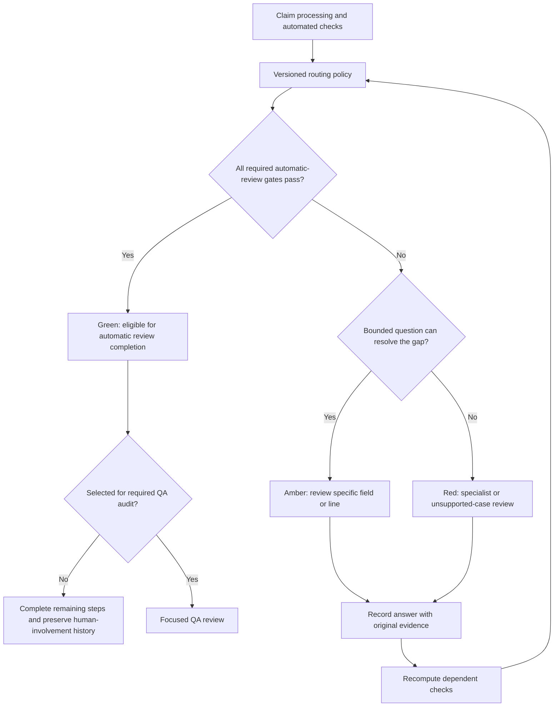
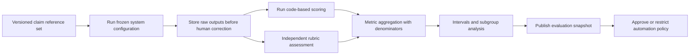

# Measuring Accuracy, Increasing Automation, and Using Human Review

**Project:** Property Claim Estimate Validator  
**Prepared:** 27 October 2026  
**Status:** Proposed measurement and automation design  
**Related documents:** [Product blueprint](PROPERTY_CLAIM_ESTIMATE_VALIDATOR.md) and [technical architecture](TECH_STACK_AND_RELIABILITY.md)

> The workspace currently contains design documents. It does not contain an evaluated claim-review application or an independently labeled test dataset. Actual project accuracy and achieved automation are therefore **not measured yet**. All numerical examples below are illustrative and must not be presented as achieved results.

## Contents

1. [What the application should prove](#1-what-the-application-should-prove)
2. [Accuracy, confidence, and automation](#2-accuracy-confidence-and-automation)
3. [Build a trustworthy reference dataset](#3-build-a-trustworthy-reference-dataset)
4. [Metrics to measure separately](#4-metrics-to-measure-separately)
5. [Worked accuracy example](#5-worked-accuracy-example)
6. [Measure automatic-review quality and coverage together](#6-measure-automatic-review-quality-and-coverage-together)
7. [Dashboard and current-claim display](#7-dashboard-and-current-claim-display)
8. [Three automation lanes](#8-three-automation-lanes)
9. [Automatic-routing policy](#9-automatic-routing-policy)
10. [Human review only where needed](#10-human-review-only-where-needed)
11. [Audit automated cases](#11-audit-automated-cases)
12. [Evaluation implementation](#12-evaluation-implementation)
13. [Data records and metric contracts](#13-data-records-and-metric-contracts)
14. [Rollout and expansion](#14-rollout-and-expansion)
15. [How to present results](#15-how-to-present-results)
16. [Acceptance checklist](#16-acceptance-checklist)
17. [Sources](#17-sources)

## 1. What the application should prove

The project needs to answer two questions:

1. How often is the system's output correct on independently checked cases?
2. How much work can it complete automatically while maintaining acceptable quality?

These should be separate measurements. A system can automate many cases and be wrong often. Another can be correct on a tiny easy subset while sending almost everything to a person.

The design goal is to increase useful automation while measuring the error rate in the automatically handled work. Humans should receive specific unresolved questions, not repeat the entire automated analysis.

## 2. Accuracy, confidence, and automation

| Term | Meaning | Appropriate display |
|---|---|---|
| Measured accuracy | Agreement with an independently reviewed reference on a defined task | Percentage, sample size, evaluation version, and uncertainty |
| Flag precision | How many raised flags were actually valid | Valid flags divided by all flags |
| Issue recall | How many known issues the system detected | Detected issues divided by known issues |
| Evidence strength | How directly the available record supports a finding | Supported, conflicting, partial, or insufficient evidence |
| Calibrated probability | A prediction score tested against observed outcomes | Optional; label the predicted event and calibration scope |
| Automation coverage | How much submitted work was completed without required manual intervention | Percentage with a clear denominator |
| Reviewer agreement | How often users accepted suggestions | Feedback metric, not independent accuracy |
| Label coverage | How much output has received a valid reference judgment | Labeled cases divided by cases in the measurement cohort |

An LLM saying 98% confident is not evidence that it is 98% accurate. Calibration checks whether predicted probabilities correspond to observed outcomes; it needs appropriate separate data and still does not establish every subgroup's reliability. [Probability calibration][A02]

For a current claim, show evidence completeness and unresolved questions. Do not label the claim 97% accurate before its correctness has been established.

## 3. Build a trustworthy reference dataset

### 3.1 The reference is the answer used for evaluation

Each evaluation case should include the documents available at a specific review point, the estimate version, expected findings, acceptable uncertainty, evidence references, and the correct financial scenario where it can be established.

Use a consistent rubric. A later negotiated settlement is not automatically the factual truth for every earlier line item. Evidence that arrived after the tested review point must not silently enter the reference input.

### 3.2 Reference labels

Useful labels include:

- Repair connection supported.
- Material contradiction requires clarification.
- Quantity discrepancy supported.
- Duplicate confirmed or duplicate candidate unresolved.
- Calculation discrepancy confirmed.
- Necessary scope potentially missing.
- Insufficient evidence.
- Policy or specialist review required.

Do not force genuinely unresolved cases into valid or invalid labels. Correctly requesting evidence can be the expected answer.

### 3.3 Independent review

Have knowledgeable reviewers assess original evidence using the rubric. For important or disputed cases, use a second reviewer and adjudicate differences.

Where feasible, label the reference before showing the AI answer. This reduces anchoring. Record reviewer disagreements rather than pretending all judgments are objective.

### 3.4 Dataset composition

Include clean claims, real issues, legitimate supporting work, missing evidence, difficult scans, revised estimates, hidden damage supported by measurements, and overlapping findings.

A small synthetic pack is useful for development and demonstrations. Claims about real-world damage recognition need representative authorized real photos and expert labels.

### 3.5 Separate development, tuning, and final evaluation

Keep claims, their photos, and all document versions together when splitting data. Do not tune prompts or routing thresholds on the final holdout set.

Use development cases to improve the system, validation cases to choose thresholds, and an untouched test set to report results. Evaluate unfamiliar vendors, formats, and later time periods where practical.

Information leakage produces overly optimistic measurements. [Data-leakage guidance][A04]

## 4. Metrics to measure separately

| Component | Recommended measurement | Important detail |
|---|---|---|
| Extraction | Exact correctness of critical fields | Separate quantity, unit, rate, total, and room fields |
| Cause comparison | Precision and recall of material conflicts | Correct clarification can be the expected outcome |
| Line-item review | Precision, recall, and F1 by issue type | Define what counts as a matching finding |
| Photo observations | Expert-reviewed observation correctness and uncertainty | Do not treat an unsupported exact area as correct |
| Evidence | Source-existence and source-support rates | A real citation can still be irrelevant |
| Financial calculation | Exact-match rate or monetary error | Separate numeric correctness from uncertain scope |
| Full claim review | Strict claim-level rubric pass rate | One missed material issue can fail the claim-level result |
| Routing | Correct auto/focused/specialist route | Evaluate false-clean outcomes and unnecessary escalation |
| Operations | Completed, failed, pending, and retried runs | Pipeline success is not domain accuracy |

### 4.1 Define the evaluation unit

An extracted field, a finding, a line item, and an entire claim are different units. Do not report 1,000 line items as 1,000 independent claims.

A single line can have more than one issue. For finding-level scoring, define a one-to-one matching rule using issue type, component, affected scope, and evidence. Do not count several paraphrases of one concern as several true positives.

Missing repair work may have no estimate line ID. Evaluate such findings against the documented component and reference issue.

### 4.2 Strict claim-review pass rate

A full claim can pass the evaluation rubric only if:

- Required material issues are found.
- No material unsupported issue is introduced.
- Uncertainty and missing evidence are handled correctly.
- Evidence supports the conclusions.
- The financial scenario is correct for the stated scope.
- Required assessable checks are complete. An unassessed result is correct only when the reference rubric expects it because prerequisites are genuinely unavailable.

Report this alongside detailed component results. Do not average extraction accuracy, photo quality, and financial accuracy into an invented overall percentage.

A skipped check that could have been performed fails the rubric. Correctly deferring a genuinely unresolved case can pass a disposition-correctness rubric, but it is not a completed substantive review. Report resolution and deferral coverage separately.

### 4.3 Separate the raw AI and assisted system

Measure the AI output before human changes and the final assisted output separately. Human corrections should not be used to make raw AI performance appear better.

Track human minutes, repeated requests, rework, and reversals. A useful assistant can reduce work even when some decisions remain manual.

## 5. Worked accuracy example

**Illustrative example only: these are not project results.**

Suppose 1,000 independently labeled line decisions have a settled binary reference: issue present or no issue. There are no unresolved reference labels in this example.

| System result | Actual issue | Actual valid line | Total |
|---|---:|---:|---:|
| Flagged | 180 true positives | 30 false positives | 210 |
| Not flagged | 20 false negatives | 770 true negatives | 790 |
| **Total** | **200** | **800** | **1,000** |

```text
Accuracy  = (180 + 770) / 1,000 = 95.00%
Precision = 180 / 210           = 85.71%
Recall    = 180 / 200           = 90.00%
F1        = 2 × 180 / 410       = 87.80%

Missed-issue rate among actual issues = 20 / 200 = 10.00%
Missed-issue share among unflagged lines = 20 / 790 = 2.53%
```

The headline accuracy is 95%, but one in ten actual issues was missed. Among raised flags, approximately one in seven was incorrect.

Precision and recall are useful when valid work and exception work are imbalanced. [Precision-recall guidance][A01]

For perspective, if only 10 of 1,000 lines had issues, flagging nothing would achieve 99% binary accuracy and 0% issue recall. This is why a single accuracy percentage is inadequate.

In real evaluation, report abstentions and missing-evidence outcomes separately. Do not remove them after seeing the results to improve the percentage.

## 6. Measure automatic-review quality and coverage together

### 6.1 Define three levels of automation

| Level | Example | What it authorizes |
|---|---|---|
| Automatic processing | Extract fields, retrieve evidence, calculate totals, draft report | Completion of defined processing tasks |
| Automatic review completion | Validated low-risk case finishes the required analysis without a mandatory reviewer | Completion of that review scope |
| Automatic business action | Apply a correction, issue payment, or make a coverage action | Only the explicitly authorized organizational action |

Automatic review completion does not itself authorize payment or denial. Those require separate policy, organizational authority, applicable requirements, and action-specific validation.

### 6.2 Overall and eligible automation

```text
Overall auto-review completion rate =
  automatically completed reviews / all submitted claims in the defined cohort

Eligible-cohort auto-review completion rate =
  automatically completed reviews / pre-defined eligible claims

Task automation rate =
  completed automatic task instances / all required task instances in that scope
```

Show unsupported, failed, pending, and deferred work. Define eligibility before observing correctness. A high percentage on an easy eligible subset does not describe all incoming claims.

Persist whether any required human intervention occurred before completion. If a person corrects a field and the system then completes the remaining steps automatically, count the claim as human-assisted. Do not reset its history when it returns to the green lane. Task automation can still include the later automatic steps.

Task counts do not measure time saved. Several quick automated tasks can be outweighed by one long manual investigation. Measure actual human effort separately.

### 6.3 Quality of the automatic subset

**Another illustrative example, separate from the line-item example:**

- 200 claims are independently adjudicated.
- 140 complete review automatically.
- 138 of those automatic reviews pass the strict correctness rubric.

```text
Automation coverage = 140 / 200 = 70.00%
Automatic-subset correctness = 138 / 140 = 98.57%
Automatic-subset error rate = 2 / 140 = 1.43%
```

These two percentages must be shown together. The system has not demonstrated 98.57% correctness on all possible claims.

### 6.4 Sample size and uncertainty

For the illustrative 138/140 result, a two-sided 95% Wilson interval is approximately 94.94% to 99.61%, assuming suitably independent representative claim observations. It does not prove 99% reliability.

Confidence intervals describe uncertainty in a measured rate. They are different from the model's confidence about an individual claim. [NIST proportion intervals][A05]

Lines from the same claim are correlated. Use claim-level estimates or suitable claim-cluster resampling for line metrics. Catastrophe events can create additional dependence that should be considered in study design.

### 6.5 Choose an automation operating point

Compare automation coverage with the independently measured error in automatic cases. A stricter policy can improve the automatic subset while reducing coverage.

Choose thresholds on validation data using error consequences and the organization's requirements. Do not use an arbitrary LLM confidence greater than 95 rule. Threshold selection must remain separate from final testing. [Threshold-tuning guidance][A03]

## 7. Dashboard and current-claim display

### 7.1 Global performance dashboard

The dashboard should have two clearly separated areas.

**Quality evidence:**

| Card | Required supporting information |
|---|---|
| Claim-review pass rate | Correct count, adjudicated count, sample interval, dataset version |
| Flag precision | Valid flags, all assessed flags, issue-type breakdown |
| Issue recall | Detected known issues, all known issues |
| Evidence-support rate | Supported findings and assessed findings |
| Financial scenario correctness | Exact matches or monetary error on eligible references |
| Audited auto-case error rate | Errors, audit count, sampling method, pending labels |

**Operational automation:**

| Card | Required supporting information |
|---|---|
| Auto-review completion | Count and all-submissions denominator |
| Eligible-cohort automation | Eligibility definition and denominator |
| Focused human-review rate | Cases/fields referred and reason breakdown |
| Specialist-review rate | Cases requiring specialist judgment |
| Incomplete or pending rate | Failures, waiting evidence, and backlog |
| QA audit workload | Audited cases and human effort |
| Human effort | Measured time and rework, with a comparison method |

Every quality card should show whether it is a held-out benchmark, live audit estimate, reviewer feedback, or synthetic illustration.

### 7.2 Initial state before evaluation

```text
QUALITY
Measured claim-review accuracy: Not measured yet
Independently adjudicated claims: 0
Flag precision / recall: Not available
Evaluation dataset: Not created

AUTOMATION
Achieved automatic-review rate: Not measured yet
Automatic actions enabled: None beyond the implemented scope
```

Do not fill empty cards with plausible-looking percentages.

### 7.3 Current claim view

Show practical facts rather than a claim accuracy score:

```text
Review scope: Internal water-loss estimate consistency
Current estimate: V2
Extraction: Complete; one quantity needs verification
Cause assessment: Unresolved source disagreement
Evidence links: Verified for the displayed findings
Price review: Not assessed; compatible reference unavailable
Coverage: Not assessed; policy missing
Routing: Focused human review required
Next action: Resolve the two cited cause statements
```

### 7.4 Illustrative automation allocation

For a 1,000-claim cohort, suppose 700 are candidates for automatic completion. Before release, 50 are selected for a required QA review. Another 200 need focused review and 100 need specialist review.

| Route | Claims |
|---|---:|
| Completed without required human review | 650 |
| Required QA audit before completion | 50 |
| Focused human review | 200 |
| Specialist review | 100 |
| **Total** | **1,000** |

The no-required-human completion rate is 65%, not 70%. The 70% figure describes the automatic-candidate route before audit holds. A later retrospective audit should be reported differently from a mandatory pre-completion audit.

## 8. Three automation lanes



### 8.1 Green lane

The required evidence is available, critical data is verified or reliably reconciled, checks are complete, no material ambiguity remains, and this action/cohort has passed the approved evaluation policy.

Green means the defined review can complete automatically. Keep its scope visible. Do not rename a factual estimate review as full coverage approval.

A green state reached after required human input is an automated continuation of a human-assisted claim. It does not contribute to the no-required-human claim completion numerator.

### 8.2 Amber lane

A specific field or item needs a person. Examples include an unclear quantity, ambiguous duplicate, or missing repair explanation. The remaining independent work continues automatically.

### 8.3 Red lane

A specialist judgment, material unresolved cause, complex coverage question, unsupported condition, or important control failure prevents the relevant automatic action.

An issue's colour should reflect its routing needs, not imply fraud or a proven overpayment.

## 9. Automatic-routing policy

### 9.1 Required gates

Automatic review completion should require all relevant conditions:

1. Claim type and format are within the evaluated scope.
2. Claim identity and active estimate are established.
3. Required inputs for the stated review scope are present.
4. Critical numeric fields reconcile or have been verified.
5. Source links and supporting evidence checks pass.
6. No unresolved material contradiction remains.
7. Necessary scope exceptions have been handled.
8. Required modules completed without hidden failure.
9. Policy/rule prerequisites exist for any policy-related action.
10. Versions and permissions are current.
11. The action/cohort has sufficient validation evidence under the approved operating policy.
12. No audit hold, drift restriction, or action-specific human requirement applies.

### 9.2 Example policy logic

```text
if pipeline_or_permission_control_failed:
    route affected work to controlled manual continuation
elif important_cause_or_specialist_question_unresolved:
    route that question to specialist review
elif critical_field_or_scope_question_unresolved:
    request focused human input
elif all_required_gates_pass and action_is_authorized:
    if mandatory_audit_selected:
        hold for QA review
    else:
        complete the defined review automatically
else:
    record incomplete state and precise next action
```

This is a conceptual policy, not an implemented approval rule. Store policy versions and test each transition.

### 9.3 Actions that can be heavily automated

| Work | Automatic behaviour | Human trigger |
|---|---|---|
| Document grouping | Classify and organize files | Identity or document-role uncertainty |
| Extraction | Read and validate supported sources | Critical ambiguity or failed totals |
| Room mapping | Assign clear aliases and context | Conflicting or unknown location |
| Evidence retrieval | Retrieve permitted source records | Required evidence unavailable |
| Arithmetic | Calculate confirmed inputs | Source meaning or calculation configuration unresolved |
| Duplicate search | Generate and verify clear candidates | Ambiguous activity, scope, or service period |
| Cause comparison | Identify agreements and disagreements | Material conflict needs investigation |
| Scope review | Complete supported cases in validated cohorts | Hidden damage or exception unresolved |
| Evidence request | Prepare a precise draft | Sending authority or substantive judgment required |
| Report preparation | Assemble validated results and sources | Required review or approval not complete |

An organization may later authorize specific automatic corrections or other actions. Each needs its own evidence requirements, permissions, evaluation, reversibility, and applicable-policy checks.

## 10. Human review only where needed

### 10.1 Ask a narrow question

Instead of assigning the entire claim, show the exact source region and question:

- Is the source quantity 120 or 1,200 SF?
- Are these two extraction charges the same service period and area?
- Does this matching report justify the additional flooring area?
- Which inspection resolves the competing cause statements?

The user should not have to rediscover the relevant evidence.

### 10.2 Reuse the answer

Store the answer with reviewer identity, source, version, and time. Automatically rerun dependent checks and update the routing decision. Do not overwrite the original source or repeat unrelated questions.

### 10.3 Separate types of human work

Track extraction correction, scope judgment, specialist investigation, business authorization, and QA audit separately. This reveals which bottleneck prevents more automation.

### 10.4 Current-version decisions

Bind decisions to the evidence, estimate, finding, calculation, and action versions. Check current state and shared financial effects within the transaction that commits an action.

LangGraph can persist a pause and resume after input, but the application must enforce access, versions, and duplicate-safe effects. [LangGraph interrupts][A08]

## 11. Audit automated cases

### 11.1 Audit the unflagged lane

If reviewers only inspect flagged cases, the system cannot reliably estimate missed issues in automatic clean reviews. Sample automatic and unflagged work as well.

### 11.2 Combine random and targeted audits

Use random sampling for representative quality estimates. Add targeted audits for new formats, material amounts, rare exceptions, or changed models.

Record inclusion probabilities and sampling groups. Report targeted results separately from population estimates unless an appropriate weighting method is used. Do not generalize a convenience sample to every submitted claim.

### 11.3 Labels can be delayed

Report assessed cases, unassessed cases, and pending disputes. A 100% approval rate among ten reviewed cases says nothing certain about the unreviewed remainder.

### 11.4 Feedback is not automatically truth

Reviewer acceptance may reflect negotiation, preferences, incomplete investigation, or model anchoring. Treat it as feedback. Use the reference rubric and adjudication process for correctness labels.

### 11.5 Respond to drift

If quality deteriorates in one format, vendor, peril, rule pack, or model version, restrict automatic actions in that cohort and investigate. Keep independent validated tasks available.

New evidence can reopen an automatic conclusion. Preserve its original snapshot and update the affected assessment.

## 12. Evaluation implementation

### 12.1 Recommended tools

| Tool | Role |
|---|---|
| Application database | Authoritative evaluation cases, decisions, and metric snapshots |
| LangSmith datasets and experiments | Compare prompt/model/workflow versions |
| LangSmith annotation queues | Organize rubric-based human feedback |
| Deterministic scorers | Exact fields, source existence, calculations, and policy transitions |
| Statistical tools | Metrics, intervals, and grouped uncertainty estimates |
| Model judges | Supporting assessment, calibrated against human review |

LangSmith documents both offline evaluation and production monitoring, plus annotation queues for structured human feedback. These tools organize evaluation; they do not create reference truth. [Evaluation types][A06], [annotation queues][A07]

### 12.2 Evaluation process



### 12.3 Reproducibility

Record dataset, model, prompt, schema, extraction, normalization, rules, routing policy, and evaluator versions. Retain the outputs actually scored.

Fresh LLM runs may differ. Reproducibility means being able to inspect the original inputs, outputs, scoring, and configuration, not promising identical regenerated text.

### 12.4 Avoid an evaluation shortcut

Do not ask the model that produced a finding to assign its own final accuracy score. An independent model judge can help, but it must be checked against expert assessment.

## 13. Data records and metric contracts

### 13.1 Unmeasured result

```json
{
  "metric": "claim_review_pass_rate",
  "status": "not_measured",
  "value_percent": null,
  "numerator": null,
  "denominator": 0,
  "dataset_version": null,
  "interval": null,
  "data_origin": "no_evaluation_dataset"
}
```

### 13.2 Illustrative result contract

```json
{
  "metric": "automatic_subset_review_correctness",
  "status": "synthetic_illustration_only",
  "value_percent": 98.5714,
  "numerator": 138,
  "denominator": 140,
  "unit": "claim",
  "interval": {
    "method": "wilson",
    "level": 0.95,
    "lower_percent": 94.9412,
    "upper_percent": 99.6074
  },
  "automation_coverage_percent": 70.0,
  "submitted_claims": 200,
  "reference": "independent_claim_review_rubric",
  "is_actual_project_result": false
}
```

### 13.3 Operational records

Store routing decision, reason codes, required human actions, task completion mode, audit selection, audit timing, human time, outcome, and reopening history.

Keep an ever-required-human-intervention flag or equivalent event history. Completion mode should distinguish unattended review, human-assisted review, and specialist-assisted review even when all three finish through the same final graph node.

Define reporting cohorts and cutoff times. Backlog, newly received claims, and delayed labels should remain visible instead of silently changing the denominator.

## 14. Rollout and expansion

1. Build a labeled development pack and deterministic scorer.
2. Freeze a separate evaluation set and report component results.
3. Run a shadow pilot with complete human review.
4. Validate specific low-risk cohorts and define routing gates.
5. Enable automatic completion of the approved review scope.
6. Maintain random audits and targeted quality checks.
7. Expand only the actions and cohorts supported by evidence.

Full human review during calibration is a temporary validation approach. The design can evolve toward exception-focused review. It is not a claim that every future claim action universally requires a human by law.

Do not expand scope solely because the aggregate score improved. A new peril, state, policy, estimate format, or automated action needs relevant validation.

## 15. How to present results

### Before actual evaluation

> We have designed separate measurements for accuracy, issue detection, financial correctness, and automation. Achieved percentages are not available yet. The displayed numerical examples are synthetic illustrations.

### After evaluation

Use a statement with placeholders filled from an actual report:

> On [N] independently assessed claims from [defined dataset], the system achieved [X]% strict claim-review correctness. Flag precision was [P]% and issue recall was [R]%. It automatically completed [A]% of submitted reviews within [defined scope]. Audited automatic cases had [E]% observed error, based on [M] assessed cases and the reported confidence interval.

### During a demonstration

Show one case that completes review automatically, one where a person verifies a single field, and one that needs specialist evidence. Then show the measured benchmark dashboard separately.

The demonstration proves the workflow. The held-out evaluation supports the performance claim. Neither should be presented as the other.

## 16. Acceptance checklist

- No model confidence is labeled measured accuracy.
- Actual results remain unavailable until evaluated.
- Every percentage has a defined task, numerator, denominator, and data origin.
- Component metrics and full-claim results remain separate.
- Precision and recall accompany headline classification accuracy.
- Missing-evidence cases and failures remain in reporting.
- Automatic-review quality and coverage appear together.
- Automatic review and financial action authority are separate.
- Human tasks target the unresolved question.
- Random audits cover automatic/unflagged work.
- Reviewer acceptance is not treated as independent accuracy.
- Current versions and authorization control decisions.
- Calibration, tuning, and holdout data are separated by claim.
- Model and routing changes trigger regression evaluation.
- The dashboard identifies synthetic, benchmark, and live-audit results.

## 17. Sources

Official documentation was checked on 27 October 2026. The product policies and examples in this document are proposed designs. Numerical examples were calculated for illustration and are not measured project outcomes.

| ID | Source | Use |
|---|---|---|
| A01 | [scikit-learn precision-recall guidance][A01] | Imbalanced classification metrics |
| A02 | [scikit-learn probability calibration][A02] | Probability versus observed correctness |
| A03 | [scikit-learn decision-threshold tuning][A03] | Separate prediction and action thresholds |
| A04 | [scikit-learn common pitfalls][A04] | Data leakage and invalid evaluation |
| A05 | [NIST proportion confidence intervals][A05] | Sample-size uncertainty and Wilson intervals |
| A06 | [LangSmith evaluation types][A06] | Offline and online evaluation |
| A07 | [LangSmith annotation queues][A07] | Structured human feedback |
| A08 | [LangGraph interrupts][A08] | Persistent human-input workflow |

[A01]: https://scikit-learn.org/stable/auto_examples/model_selection/plot_precision_recall.html
[A02]: https://scikit-learn.org/stable/modules/calibration.html
[A03]: https://scikit-learn.org/stable/modules/classification_threshold.html
[A04]: https://scikit-learn.org/stable/common_pitfalls.html
[A05]: https://www.itl.nist.gov/div898/handbook/prc/section2/prc241.htm
[A06]: https://docs.langchain.com/langsmith/evaluation-types
[A07]: https://docs.langchain.com/langsmith/annotation-queues
[A08]: https://docs.langchain.com/oss/python/langgraph/interrupts
