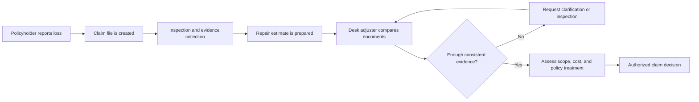
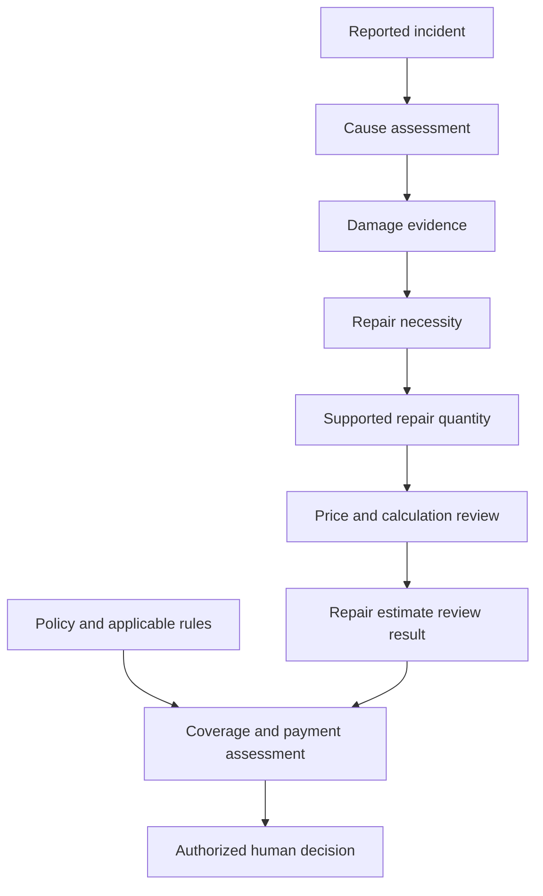
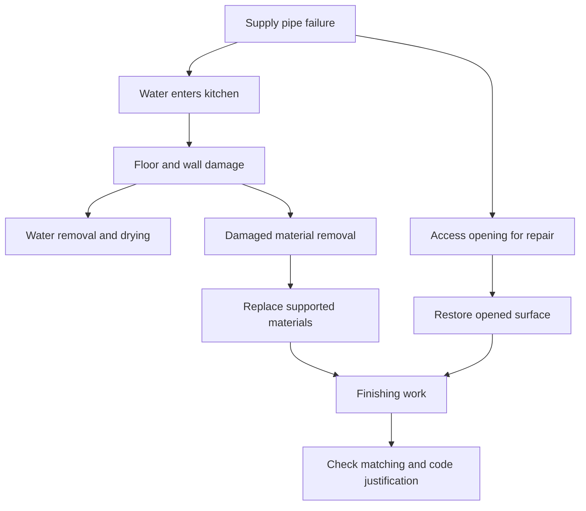
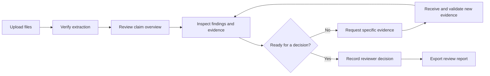
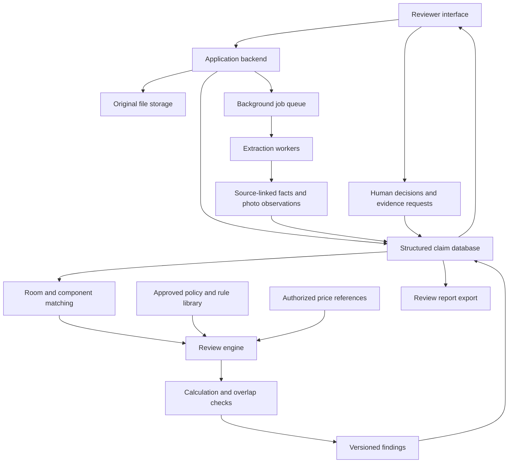
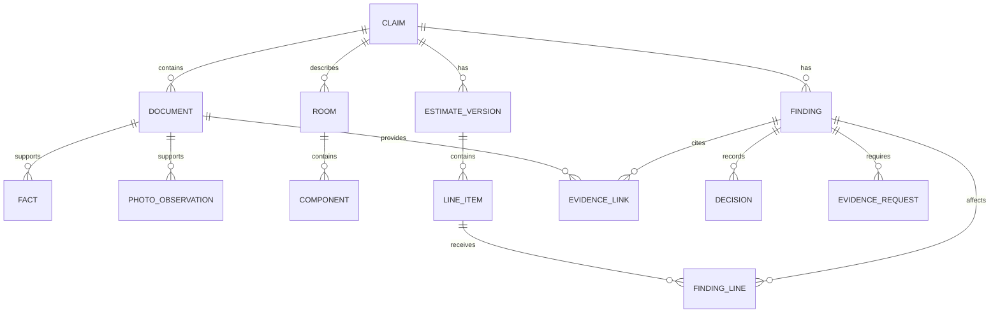
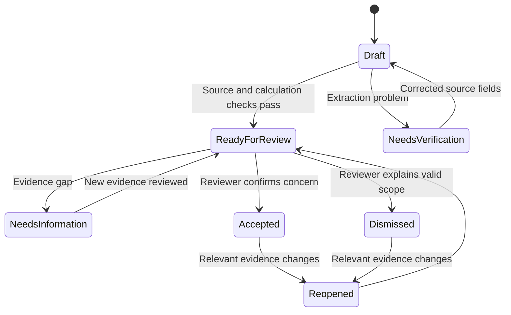
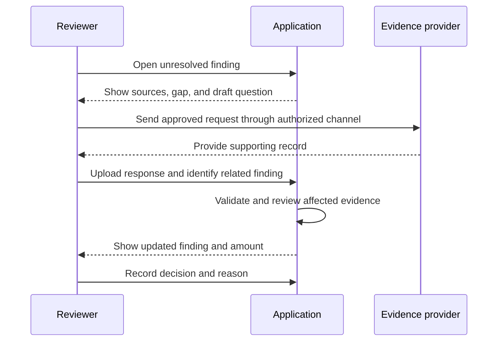
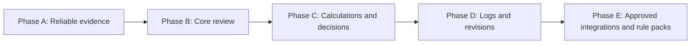

# Property Claim Estimate Validator

## Detailed Product and Technical Design

**Prepared:** 27 October 2026  
**Language:** Simple English  
**Document type:** Research-backed project blueprint  
**Primary user:** Property insurance desk adjuster  
**Recommended first scope:** Residential internal water-leak claims

**Technical companion:** [Technology stack, AI workflow, human review, and reliability design](TECH_STACK_AND_RELIABILITY.md)

**Measurement companion:** [Accuracy measurement, automation, and targeted human review](ACCURACY_AUTOMATION_AND_HUMAN_REVIEW.md)

> This document describes a proposed system. It does not claim that the features are already built or that the system has achieved any accuracy, savings, or processing-time result. The examples and prices are illustrative unless a source is explicitly named.

The original challenge mentions dollar amounts and state guidelines. This document therefore uses a United States property-insurance context. A deployment in another country needs a different policy and regulatory knowledge base.

---

## Contents

1. [Project purpose](#1-project-purpose)
2. [Users and the current workflow](#2-users-and-the-current-workflow)
3. [The six questions a reviewer must answer](#3-the-six-questions-a-reviewer-must-answer)
4. [User problems and project solutions](#4-user-problems-and-project-solutions)
5. [Product principles and decision boundaries](#5-product-principles-and-decision-boundaries)
6. [Feature catalogue and priorities](#6-feature-catalogue-and-priorities)
7. [Application screens and user journey](#7-application-screens-and-user-journey)
8. [System architecture](#8-system-architecture)
9. [Data model and evidence structure](#9-data-model-and-evidence-structure)
10. [Detailed review process](#10-detailed-review-process)
11. [Financial impact and calculation rules](#11-financial-impact-and-calculation-rules)
12. [Policy and jurisdiction rules](#12-policy-and-jurisdiction-rules)
13. [Photo analysis and evidence collection](#13-photo-analysis-and-evidence-collection)
14. [Review workflow, explanations, and audit history](#14-review-workflow-explanations-and-audit-history)
15. [Security and operational requirements](#15-security-and-operational-requirements)
16. [Data strategy and test-case design](#16-data-strategy-and-test-case-design)
17. [Evaluation and acceptance criteria](#17-evaluation-and-acceptance-criteria)
18. [MVP and development roadmap](#18-mvp-and-development-roadmap)
19. [Worked claim example and demo script](#19-worked-claim-example-and-demo-script)
20. [Integration and pricing-data strategy](#20-integration-and-pricing-data-strategy)
21. [Differentiation and business value](#21-differentiation-and-business-value)
22. [Risks, limitations, and open decisions](#22-risks-limitations-and-open-decisions)
23. [Project explanation and presentation wording](#23-project-explanation-and-presentation-wording)
24. [Glossary](#24-glossary)
25. [Research sources](#25-research-sources)

The diagrams use Mermaid. A Markdown viewer with Mermaid support can render them. The text and tables also explain the main relationships so the document remains useful without diagram rendering.

---

## 1. Project purpose

### 1.1 The problem

A property repair estimate is a list of proposed services and charges. It may contain repair work, demolition, drying, equipment rental, materials, labour, disposal, and other costs.

A desk adjuster must compare that estimate with the reported incident, inspection findings, photos, and policy information. The same property may be described differently across documents. Some costs may be unsupported, repeated, incorrectly calculated, or larger than the documented repair scope. Other necessary repairs may be missing.

Today, the challenge described in the problem statement is handled through manual document review. A reviewer has to find evidence, compare facts, perform calculations, request clarification, and explain decisions.

### 1.2 The proposed solution

Build an **evidence-backed claim review assistant** that:

1. Reads the claim documents and photos.
2. Extracts facts without losing their original sources.
3. Identifies differences between the reported cause and inspection findings.
4. Connects each estimate item to a room, component, damage description, and repair reason.
5. Checks quantities, duplicate charges, calculations, and supplied price references.
6. Identifies missing evidence and potentially missing repair work.
7. Shows the possible financial effect without presenting uncertain amounts as confirmed savings.
8. Lets an authorized human reviewer make and record the decision.

### 1.3 The core product promise

> For every questioned repair item, show what is being questioned, why it matters, what original evidence supports the concern, what evidence points the other way, and what should happen next.

### 1.4 What success looks like

A useful result is more than a red flag. A reviewer should be able to open a finding and immediately understand:

- The exact estimate line or lines involved.
- The relevant reported facts and photo observations.
- Whether the issue is a proven calculation difference, a potential inconsistency, or missing evidence.
- The financial calculation and its assumptions.
- Any valid reason that could explain the item.
- The next action and the person responsible.

The product should improve review quality and reduce avoidable work. Any improvement must be measured in a pilot before it is presented as an achieved result.

### 1.5 Mapping to the original challenge

| Challenge requirement | Proposed implementation | What to demonstrate |
|---|---|---|
| Document intake | Supported PDF, scan, image, and spreadsheet extraction with verification | Upload a complete packet and correct an unclear field |
| Cause-of-loss validation | Source-by-source fact comparison and unresolved-cause tracking | Show a FNOL/report disagreement with both original passages |
| Damage image analysis | Visible-condition observations, room mapping, and evidence gaps | Link a photo to a component and explain its limits |
| Estimate line-item review | Repair connection, quantity, activity, and overlap checks | Explain why one item is supported and another needs review |
| Exception flags with dollar impact | Typed findings and transparent, non-overlapping calculations | Show a quantity difference and a duplicate candidate |
| Clear evidence | Stable links to source text, photos, and measurements | Open the exact source behind a material finding |

The phrase any format should be treated as a long-term intake goal. The prototype should be judged against its declared supported formats rather than pretending every file can be read correctly.

## 2. Users and the current workflow

### 2.1 Main users

| User | What the user does | What the application should provide |
|---|---|---|
| Desk adjuster | Reviews the claim file and proposed estimate | A complete evidence view, useful findings, calculations, and decision controls |
| Field adjuster | Inspects the property and documents damage | A clear checklist of missing measurements, photos, and observations |
| Claims supervisor | Reviews exceptions and quality | A queue of material unresolved issues and a traceable decision history |
| Contractor or restoration vendor | Provides estimates, invoices, and repair explanations | Specific clarification requests, where a collaboration workflow is authorized |
| Quality or compliance reviewer | Checks the process and applicable rules | Source records, rule versions, review decisions, and reproducible calculations |
| Policyholder | Reports the loss and provides information | Fewer repeated questions and clearer explanations through the insurer's workflow |

The first version should focus on the desk adjuster. A separate customer portal is optional.

### 2.2 Typical input material

| Input | Typical content | Important limitation |
|---|---|---|
| FNOL: First Notice of Loss | Initial description, date, address, affected rooms | It is an initial account and may be incomplete or later corrected |
| Adjuster report | Inspection observations, possible cause, measurements, scope | It may contain errors, qualifications, or unresolved opinions |
| Damage photos | Visible property condition | They may not show hidden damage, exact dimensions, or the original condition |
| Repair estimate | Services, quantities, units, rates, taxes, totals | It is a proposed repair scope and cost, not independent proof of damage |
| Sketch or measurement sheet | Room dimensions and component measurements | Measurements may be incomplete or use a different room naming scheme |
| Drying logs | Equipment, dates, moisture readings, drying progress | Missing logs do not by themselves prove that work was not performed |
| Policy and endorsements | Coverage terms, limits, exclusions, settlement conditions | Correct policy version and applicable endorsements are essential |
| Invoices and receipts | Work performed or costs incurred | An invoice still needs to be linked to the correct loss and scope |
| Earlier estimates and payments | Claim development and previous amounts | Superseded documents must not be added as new charges |

### 2.3 Current workflow



An insurer's actual process may differ. For example, emergency mitigation can start before the full repair estimate is prepared.

The NAIC explains that claim adjustment includes policy review, deductibles, and coverage limits, and that similar-looking damage can lead to different settlements. [NAIC settlement guidance][S02]

## 3. The six questions a reviewer must answer

These questions should remain separate in the product. Solving one does not automatically solve the others.

| Question | Meaning | Example |
|---|---|---|
| 1. What happened? | The reported event and possible cause | A supply pipe failed in the kitchen |
| 2. What was damaged? | The affected rooms, materials, and components | Kitchen flooring and part of a hallway wall |
| 3. What repair work is necessary? | The repair method and supporting operations | Remove damaged flooring, dry materials, restore finishes |
| 4. How much work is necessary? | The supported repair quantity | A measured repair area, including justified additional work |
| 5. Is the price supported? | Rate, market, period, grade, and job conditions | A local rate or contractor quote with an explained adjustment |
| 6. What does the policy pay? | Coverage, limits, depreciation, deductibles, and previous payments | A payment calculation based on the actual policy |



If the cause remains disputed, the application can still identify an arithmetic error. It should avoid presenting uncertain cause-dependent findings as settled conclusions.

## 4. User problems and project solutions

### 4.1 Problem 1: Information is scattered across files

**What the user faces:** The reviewer opens several PDFs, a spreadsheet, and an image folder to understand one claim. The same search is repeated for many estimate items.

**Project solution:** Create one claim workspace. Store document type, version, room references, and links between evidence and estimate lines.

**Example:** Clicking a kitchen drywall line opens the related report paragraph, measurement sheet, and kitchen photos.

**Implementation detail:** Use stable IDs for claims, documents, pages, photos, rooms, and estimate items. Keep originals and derived records connected.

**Benefit to verify:** Less time spent finding and reopening evidence.

### 4.2 Problem 2: Data extraction can create false findings

**What the user faces:** A scanned table is read incorrectly. A decimal moves, a row is skipped, or a quantity becomes a rate.

**Project solution:** Use native text extraction where available and OCR for scanned content. Validate table structure and reconcile extracted totals. Provide a correction screen.

**Example:** The source says 120 SF, but extraction produces 1,200 SF. The application marks the field for verification before calculating a scope difference.

**Implementation detail:** Every extracted field should retain its source page and text location. A correction creates a new field version and triggers review of dependent findings.

**Boundary:** The application must publish a supported-format list. An unreadable, encrypted, or unsupported file should produce a clear intake issue rather than invented content.

### 4.3 Problem 3: FNOL and inspection findings disagree

**What the user faces:** One document says a pipe leaked. Another says rain entered through the roof. Dates, rooms, or material descriptions may also differ.

**Project solution:** Compare facts by topic and show a contradiction panel. Preserve both statements and any qualifications.

**Example:** FNOL reports a kitchen pipe failure; the report attributes ceiling staining to roof entry. The result is an unresolved cause question with links to both sources.

**Implementation detail:** Label a statement as reported, observed, inferred, or unresolved. Do not automatically make the latest document the truth.

**Boundary:** A later inspection can legitimately correct an early account. A difference is a review trigger, not proof that anyone is dishonest.

### 4.4 Problem 4: The cause category is too broad

**What the user faces:** A document only says water damage. That description does not explain the source, route, or timing of the water.

**Project solution:** Use a cause structure: source, mechanism, entry route, timing, and resulting damage. Keep coverage analysis separate.

**Example:** A failed supply line, sewer backup, and outside surface flooding should not be treated as the same event.

**Implementation detail:** Allow multiple candidate causes and multiple contributing events. Ask for a plumber's report, roof inspection, or other specialist evidence where appropriate.

**Research basis:** The Maryland Insurance Administration distinguishes several water-loss scenarios and related coverage considerations. The actual policy still controls the assessment. [Maryland water-damage guidance][S03]

### 4.5 Problem 5: Billed locations do not match documented damage

**What the user faces:** The report mentions the kitchen and hallway, while the estimate adds bedroom work without an explanation.

**Project solution:** Build a room-by-room damage and repair matrix. Connect every line to a room and component where possible.

**Example:** A bedroom flooring line has no linked inspection finding. The system asks whether continuous flooring, matching, access, or new inspection evidence explains it.

**Implementation detail:** Resolve room aliases such as KIT and Kitchen. Let the user correct room assignments and split a line across rooms.

**Boundary:** A room absent from the FNOL may still contain valid damage discovered later. Check the whole file before raising a material concern.

### 4.6 Problem 6: Photos are incomplete or interpreted too confidently

**What the user faces:** Photos may be blurred, taken after cleanup, missing context, or focused on a different surface. Hidden moisture may not appear in an ordinary image.

**Project solution:** Check image quality, suggest room labels, describe visible conditions, and identify missing evidence.

**Example:** The image shows wall discoloration but cannot establish the wet area behind the wall. The application requests moisture readings or an inspection record.

**Implementation detail:** Keep the original photo, source caption, model observation, user correction, and annotation separate.

**Boundary:** Do not infer exact square footage, structural safety, damage age, or a definitive cause from an uncalibrated ordinary photo. EPA describes hidden mold locations and the use of investigation tools such as moisture meters. [EPA moisture and mold guidance][S04]

### 4.7 Problem 7: Repair quantities may exceed supported scope

**What the user faces:** The estimate bills 300 SF while the documented repair scope supports 120 SF. Alternatively, measurements use incompatible units.

**Project solution:** Recalculate quantities from reliable measurements and compare them with billed scope. Check whether additional area is justified.

**Example:** At an illustrative $3/SF, a 180 SF difference creates a potential $540 base-cost difference.

**Implementation detail:** Distinguish floor area, wall area, linear trim, waste, and equipment-days. A room's floor dimensions do not directly provide its wall repair area.

**Boundary:** Visible stain area is not automatically the required repair area. California's claims guide distinguishes damage observations and raw measurements from the completed estimate. [California claims guide][S01]

### 4.8 Problem 8: Necessary supporting work appears unrelated

**What the user faces:** A pipe-loss estimate includes drywall removal, drying, insulation, painting, and moving contents. A basic keyword system may reject these different trades.

**Project solution:** Create a repair dependency map. Explain how each supporting operation connects to access, mitigation, restoration, matching, or code requirements.

**Example:** A wall is opened to access a damaged pipe. Restoring the opened wall can be connected to the repair process even if the whole wall was not originally wet.

**Implementation detail:** Store a justification category for each line. Ask for supporting scope notes when the connection is not established.

**Boundary:** A plausible dependency is a candidate explanation. It still needs evidence and, for payment, applicable policy treatment.



The diagram shows possible relationships. It does not establish that every operation is needed or covered on every claim.

### 4.9 Problem 9: Duplicate and bundled charges are difficult to identify

**What the user faces:** Similar work appears in two invoices or under different descriptions. Sometimes one item already includes another activity.

**Project solution:** Compare service, activity, room, surface, quantity, date, vendor, and estimate version. Detect exact repeats and possible partial overlaps.

**Example:** A remove-and-replace line includes removal, while a separate line bills removal for the same material and area.

**Implementation detail:** Understand activity definitions. A removal line plus a replace-only line can be valid. The relevant estimating system's item definition matters. [Xactimate activity documentation][S05]

**Boundary:** Text similarity is only a candidate-generation method. It is not enough to confirm a duplicate or calculate its impact.

### 4.10 Problem 10: Arithmetic and unit errors are missed

**What the user faces:** Quantity times rate is wrong, a total does not reconcile, or incompatible units are compared.

**Project solution:** Use normal code for calculations, unit checks, and total reconciliation. Use AI to explain the result in plain language.

**Example:** 80 units at $4 should produce a $320 base amount, but the extracted base amount is $420. The potential difference is $100 if the fields are confirmed.

**Implementation detail:** Respect the estimate's tax basis, minimum charges, rounding, discounts, and overhead/profit settings. Preserve material, labour, and equipment breakdowns when available.

**Boundary:** An apparent mismatch may be a hidden or separately displayed adjustment. Resolve the estimate structure before calling it an error.

### 4.11 Problem 11: Drying-equipment charges lack a clear evidence trail

**What the user faces:** Equipment count and rental days are billed, but deployment records and moisture readings do not clearly support them.

**Project solution:** Reconcile equipment-days with logs, dates, room assignments, and drying progress.

**Example:** Six air movers are billed for seven days. Available records show four units for five days. The system identifies the unsupported portion of the record and requests clarification.

**Implementation detail:** Treat quantity, duration, and rate as separate dimensions. A dated photo may show some equipment but not prove the full deployment duration.

**Boundary:** Do not impose a universal drying-duration limit. NFIP guidance provides a useful documentation example, but its requirements belong to that program. [NFIP Claims Manual][S06]

### 4.12 Problem 12: Price comparisons ignore job context

**What the user faces:** A rate is compared against the wrong region, month, unit, material grade, or work condition.

**Project solution:** Match benchmarks to relevant job characteristics and show the basis of comparison. Accept documented quotes and justified overrides.

**Example:** A rate is 18% above a supplied reference. The application reports the variance and asks for job-specific support; it does not automatically call the difference an overpayment.

**Implementation detail:** Store benchmark provider, region, period, unit, item definition, and licence or authorization details.

**Boundary:** If a suitable reference is missing, price review should remain unassessed. Verisk describes market-based pricing and explains that published prices may not fit every job. [Verisk pricing methodology][S07]

### 4.13 Problem 13: Repair validity is confused with insurance coverage

**What the user faces:** A repair is related to the incident, so the system assumes the insurer must pay it. The reverse can happen when a coverage question is mistaken for a damage question.

**Project solution:** Produce separate results for factual consistency, repair necessity, quantity, pricing, and coverage.

**Example:** Flooring damage may be supported, while payment still depends on the policy, deductible, exclusions, limits, and settlement basis.

**Implementation detail:** The four core challenge inputs support a factual review. A coverage module needs the actual policy and endorsements.

**Boundary:** Missing policy documents should produce Coverage not assessed. They should not prevent unrelated arithmetic checks from running.

### 4.14 Problem 14: Jurisdiction rules can justify additional scope

**What the user faces:** Matching, adjoining-area repair, and code requirements are handled as if one rule applies everywhere.

**Project solution:** Use a versioned rule library with policy and jurisdiction applicability. Show the specific rule and why it may apply.

**Example:** A replacement material does not match adjoining material. The application requests matching evidence rather than automatically removing all adjoining-area costs.

**Implementation detail:** Include jurisdiction, product/program, policy terms, relevant dates, exceptions, and rule-review status.

**Boundary:** Florida's statute has policy qualifications and a reasonableness assessment. It is not a universal requirement to replace an entire room or house. [Florida Statutes section 626.9744][S08]

### 4.15 Problem 15: Estimate value is confused with payable value

**What the user faces:** Repair cost, depreciation, deductible, limits, and previous payments are combined into a single unclear number.

**Project solution:** Show separate financial fields and a traceable calculation sequence.

**Example:** A $15,000 repair estimate does not mean the policyholder is immediately due $15,000. The settlement basis and policy terms matter.

**Implementation detail:** Keep repair-cost corrections separate from changes to payable amounts. Support multiple coverages and applicable deductibles when the policy module is added.

**Research basis:** Texas explains the difference between replacement-cost and actual-cash-value settlement. [Texas Department of Insurance][S09]

### 4.16 Problem 16: Revised estimates are counted as new charges

**What the user faces:** An original $8,000 estimate and a revised $10,000 estimate are added together even though the second replaces the first.

**Project solution:** Track document relationships and compare versions. Distinguish replacement estimates, incremental supplements, invoices, and payment records.

**Example:** The current estimate is $10,000, with a $2,000 increase from the original. The application explains which scope or prices changed.

**Implementation detail:** Let the reviewer confirm whether a document supersedes another. Do not infer this solely from its filename.

**Boundary:** Additional damage or initially missed items can support a legitimate supplement. [NFIP claims checklist][S10]

### 4.17 Problem 17: Necessary repair items are missing

**What the user faces:** A review focused only on reductions can overlook under-scoping and legitimate customer damage.

**Project solution:** Check in both directions: estimate to evidence, and documented damage to estimate.

**Example:** The report documents damaged insulation, but the estimate only includes drywall work. The application asks whether insulation reinstatement is missing or already bundled elsewhere.

**Implementation detail:** Use repair dependencies and item definitions to identify omissions. Treat possible missing work as a review issue rather than automatically adding a charge.

**Benefit to verify:** More complete repair estimates and fewer avoidable follow-up disputes or supplements.

### 4.18 Problem 18: Findings are difficult to explain and act on

**What the user faces:** A generic AI warning does not tell the reviewer what to verify, how much is affected, or what to ask the contractor.

**Project solution:** Use a consistent finding card with linked evidence, counter-evidence, uncertainty, calculation, and next action. Record reviewer decisions and reasons.

**Example:** A roof line is flagged because its connection to the reported plumbing loss is not established. The suggested action requests the roof inspection or a separate loss explanation.

**Implementation detail:** Separate issue category, evidence strength, financial materiality, and review state. A large amount does not mean the evidence is strong.

**Research basis:** The NAIC AI model bulletin supports governance, testing, and documentation expectations. It is a model bulletin, not automatically a law in every state. [NAIC AI bulletin][S11]

## 5. Product principles and decision boundaries

### 5.1 Preserve disagreements

Store what each source says. Do not quietly replace conflicting statements with a single model-generated summary. A summary should expose important unresolved differences.

### 5.2 Separate an observation from an inference

- Observation: The photo shows a brown ceiling stain.
- Reported statement: The inspector attributes the stain to a roof leak.
- Inference: Roof entry may explain the stain.
- Decision: The reviewer accepts or rejects a proposed repair after considering the full evidence.

These are different record types.

### 5.3 Missing evidence is a valid outcome

An absent photo does not prove absent damage. An absent invoice does not prove that a service was never performed. The application should clearly state what cannot yet be established.

### 5.4 Recognize justified additional work

The visible damaged spot may be smaller than the repair area. Access, finishing continuity, matching, mitigation, and code conditions can matter. Require support for these explanations without assuming they are always valid.

### 5.5 Use code for money and units

Calculate amounts with decimal-safe arithmetic. Recalculate findings after a source correction. Keep the estimate's calculation settings available for inspection.

### 5.6 Keep AI recommendations separate from authority

The application recommends reviews and explains evidence. Authorized users control claim decisions. A system finding should never be presented as proof of fraud or as an automatic denial.

### 5.7 Measure both over-scoping and under-scoping

The product should help reach a supported claim outcome. It should not optimize only for larger reductions.

## 6. Feature catalogue and priorities

Use three practical levels:

- **MVP:** Needed to demonstrate the core challenge reliably.
- **Next:** Valuable after the core workflow works.
- **Advanced:** Requires more data, specialist knowledge, integrations, or operational maturity.

| Feature | What it does | Required input | Priority |
|---|---|---|---|
| Claim workspace | Groups all evidence and review activity | Claim ID and uploaded files | MVP |
| Document classification | Identifies FNOL, report, estimate, photo, and supporting records | File content and metadata | MVP |
| Text and table extraction | Creates structured fields while retaining source locations | Supported documents | MVP |
| Extraction correction | Lets users verify unclear or inconsistent fields | Original page plus extracted field | MVP |
| Cause comparison | Finds competing statements about the incident | FNOL and report | MVP |
| Room and component mapping | Links estimate work to locations and materials | Documents, room labels, photos | MVP |
| Photo observations | Describes visible conditions and quality limitations | Supported images | MVP |
| Unexplained-work review | Finds work without an established loss connection | Estimate plus evidence map | MVP |
| Duplicate candidates | Detects repeated or overlapping charges | Normalized lines and document versions | MVP |
| Quantity and arithmetic checks | Reviews units, extensions, and supported amounts | Quantities, rates, measurements | MVP |
| Evidence viewer | Opens the exact supporting source | Source references | MVP |
| Financial-impact calculator | Computes non-overlapping amounts requiring review | Valid line data and assumptions | MVP |
| Reviewer actions | Confirms, dismisses, or requests information | Finding and reviewer identity | MVP |
| Review report | Exports findings and decisions | Current review version | MVP |
| Targeted evidence requests | Drafts specific questions for unresolved issues | Missing-evidence records | Next |
| Estimate-version comparison | Explains additions, removals, and changes | Related estimate documents | Next |
| Missing-scope detection | Finds documented damage without a repair item | Damage facts and item definitions | Next |
| Drying-log reconciliation | Compares equipment billing with records | Logs, dates, equipment lines | Next |
| Claim timeline | Displays events, inspections, work, and revisions | Dated facts | Next |
| Claim question answering | Answers questions with original evidence links | Indexed claim evidence | Next |
| Guided photo collection | Requests the views needed to resolve questions | Evidence gaps and capture workflow | Next |
| Policy-aware review | Retrieves and applies policy terms for review | Correct policy and endorsements | Advanced |
| Jurisdiction rule packs | Checks verified applicable rules | Location, product, dates, approved rules | Advanced |
| Contextual rate checks | Compares against authorized local references | Compatible benchmark data | Advanced |
| Prior-loss comparison | Checks relevant earlier damage and repairs | Authorized historical claim data | Advanced |
| Weather corroboration | Adds event context for a location and date | Authorized weather data | Advanced |
| Estimating-system integration | Exchanges data through supported interfaces | Vendor agreement and credentials | Advanced |
| Supervisor analytics | Tracks unresolved work and review quality | Sufficient reviewed claims | Next |

### 6.1 High-value additions

**Evidence for and against a concern:** Show why a line may be unsupported and why it may still be legitimate. This helps avoid one-sided explanations.

**What would resolve this issue:** Convert a finding into a specific evidence request. For example: provide the moisture map for the hallway, not simply provide more documents.

**Change impact:** When a measurement is corrected, show which findings and amounts changed.

**Missing-scope review:** Give legitimate omitted repairs the same visibility as potential excess charges.

### 6.2 Features to postpone

Avoid starting with all-peril expertise, autonomous claim payment, universal legal compliance, or exact measurement from ordinary photos. These promises require evidence and capabilities beyond a focused prototype.

## 7. Application screens and user journey

### 7.1 Screen 1: Claim intake

The user creates or opens a claim and uploads files. The screen shows supported types, file status, detected document type, and missing core inputs.

Useful controls include correcting a document type, marking a file as a revised estimate, and assigning unlabeled photos to rooms.

### 7.2 Screen 2: Extraction verification

Show the original page beside extracted facts. Highlight unreadable values, inconsistent totals, and incompatible units. Let the reviewer fix values without changing the original document.

### 7.3 Screen 3: Claim overview

Show the reported event, candidate cause, affected rooms, document completeness, current estimate version, and unresolved questions. Do not hide contradictions inside a smooth summary.

### 7.4 Screen 4: Cause and fact comparison

Compare relevant facts across documents. Include the exact statements, source dates, and links. Allow a reviewer to record a resolution and its supporting evidence.

### 7.5 Screen 5: Room and damage view

For each room, show photos, observed conditions, report statements, measurements, and proposed work. A room matrix is often enough for the MVP; a 3D model is optional.

| Room and component | Report evidence | Photo evidence | Proposed work | Current assessment |
|---|---|---|---|---|
| Kitchen flooring | Damage described | Relevant images available | Flooring replacement | Supported connection; quantity still needs verification |
| Hallway wall | Damage described | Image unclear | Drywall and finish work | Additional evidence needed |
| Bedroom flooring | Not documented | No assigned images | Full replacement | Ask about matching, continuous material, or additional damage |

This example separates a supported repair connection from a fully validated quantity or payment decision.

### 7.6 Screen 6: Estimate review

A practical layout has three areas:

| Area | Content |
|---|---|
| Left | Estimate lines, room filters, and issue filters |
| Centre | Finding explanation, assumptions, amount, and reviewer controls |
| Right | Original PDF page, photo, measurement, or rule reference |

Allow filtering by unresolved amount, issue type, evidence gap, and review state. Keep evidence strength separate from amount.

### 7.7 Screen 7: Requests and decisions

Draft targeted clarification requests. The authorized user chooses whether and how to send them. Store responses as new evidence and rerun affected checks.

### 7.8 Screen 8: Final review report

Include source inventory, current estimate version, findings, accepted corrections, unresolved items, unassessed modules, and reviewer decisions. State assumptions beside amounts.



## 8. System architecture

### 8.1 Recommended structure

Start with one application backend divided into clear modules. Use background jobs for expensive extraction and review tasks. Split services later only when scale or operational needs justify it.

The main components are:

1. Web interface for intake, evidence review, and decisions.
2. Application backend for claim access, workflow, and validation.
3. File storage for original documents and derived previews.
4. Relational database for structured facts, findings, and history.
5. Extraction workers for text, tables, and image preparation.
6. Review engine for rules, document reasoning, and photo observations.
7. Calculation engine for financial effects.
8. Export module for reports.



### 8.2 Extraction strategy

- Read existing PDF text before using OCR.
- Use OCR when a page is scanned or its text layer is unusable.
- Preserve row boundaries and page order in estimates.
- Read supported spreadsheets directly when available.
- Keep original values and normalized values separately.
- Validate arithmetic and document totals before downstream analysis.
- Route ambiguous fields to review instead of guessing.

Handle repeated headers, rows continued across pages, subtotal rows, negative credits, and different decimal or currency formats. Handwritten notes should be marked uncertain when they cannot be read reliably. A subtotal is not a new service line, and an existing credit must not be treated as an additional positive charge.

### 8.3 Evidence retrieval

The review engine should retrieve relevant evidence for the line being checked. For a kitchen flooring line, that may include kitchen report passages, flooring photos, measurements, and relevant repair notes.

This is often called retrieval-augmented generation, or RAG. It means giving the model relevant source material before asking it to explain a result.

Retrieval is not proof. The application must still verify that cited passages exist and support the explanation. Search by structured fields first; add semantic search when it improves retrieval. A dedicated vector database is not required for the first version.

### 8.4 Responsibilities of AI and normal code

| Task | Main approach | Reason |
|---|---|---|
| Add amounts and calculate differences | Normal code | Repeatable, exact calculations |
| Check units and required fields | Normal code | Clear validation rules |
| Identify identical file uploads | File hashes | Reliable file identity |
| Find semantically similar descriptions | Text models plus structured filters | Different wording may describe similar work |
| Compare reported causes | Language model with source verification | Requires interpretation and context |
| Describe visible image conditions | Vision model with review controls | Useful observations with known limits |
| Apply verified numeric thresholds | Versioned rules | Consistent, explainable behaviour |
| Decide whether to pay or deny | Authorized human workflow | Requires policy authority and full assessment |

### 8.5 Processing and failure handling

Use visible stages such as Uploaded, Extracting, Needs verification, Reviewing, and Ready for review. If one photo fails, keep the remaining valid evidence available and mark the affected review as incomplete.

Retry temporary failures without creating duplicate findings. Record job IDs, input versions, and errors. Rerun only the checks affected by changed evidence where practical.

Uploaded document content is evidence, not a source of instructions for the application. Text inside a document must not be allowed to change system rules or trigger external actions.

## 9. Data model and evidence structure

### 9.1 Core records

| Record | Purpose | Important fields |
|---|---|---|
| Claim | The overall loss file | Claim ID, location, relevant dates, product, status |
| Document | An uploaded source | Type, hash, version, source, upload time, superseded-by link |
| Source location | A specific part of a source | Page, text span, table row, image region |
| Fact | A source-linked statement or value | Raw value, normalized value, fact type, extraction status |
| Room | A location within the property | Stable ID, name, aliases, floor |
| Component | A surface or building element | Room, material, dimensions where supported |
| Photo observation | A description linked to an image | Visible condition, room candidate, uncertainty, annotation |
| Estimate version | A priced scope snapshot | Relationship to earlier versions, totals, calculation settings |
| Line item | A proposed charge | Code, activity, quantity, unit, rate, components, amount |
| Finding | A review concern or omission | Type, affected lines, evidence, amount basis, status |
| Evidence request | A question needed for resolution | Requested record, reason, owner, response |
| Decision | A human disposition | Reviewer, reason, evidence considered, time |
| Rule version | An approved check or policy reference | Applicability, source, version, effective period, exceptions |
| Payment record | An actual payment, where available | Coverage, amount, date, source, relationship to claim |



The diagram is conceptual. A production schema may use additional link tables for facts, components, rule references, and cross-document relationships.

### 9.2 Example fact record

```json
{
  "fact_id": "FACT-021",
  "claim_id": "DEMO-001",
  "document_id": "REPORT-01",
  "document_version": 1,
  "page": 3,
  "text_span": {"start": 450, "end": 492},
  "raw_text": "Water damage observed to kitchen flooring.",
  "fact_type": "reported_inspection_observation",
  "room_id": "ROOM-KITCHEN",
  "component": "flooring",
  "normalized_value": "water_damage_reported",
  "verification_status": "extracted_not_human_verified"
}
```

In this example, page numbers start at 1. Text offsets start at 0 and use an end-exclusive boundary: the start is included and the end is not. Text offsets are useful only against a stable stored page-text version. Keep that version available. For scanned pages, page coordinates can provide a more useful visual reference.

### 9.3 Example finding record

```json
{
  "finding_id": "F-028",
  "claim_id": "DEMO-001",
  "estimate_version_id": "EST-V2",
  "affected_line_ids": ["L28"],
  "issue_type": "cause_connection_unresolved",
  "summary": "The loss connection for roof replacement is not established.",
  "supporting_fact_ids": ["FACT-001", "FACT-021"],
  "counter_evidence_fact_ids": [],
  "missing_evidence": ["roof inspection or separate loss explanation"],
  "amount_under_review": "4000.00",
  "currency": "USD",
  "amount_basis": "pre_tax_line_amount",
  "proposed_correction": null,
  "evidence_strength": "limited",
  "workflow_status": "needs_information",
  "model_version": "record_actual_deployed_version",
  "prompt_template_version": "record_actual_template_version",
  "extraction_pipeline_version": "record_actual_extraction_version",
  "normalization_pipeline_version": "record_actual_normalization_version",
  "ruleset_version": "record_actual_ruleset_version",
  "reviewer_decision": null
}
```

This example deliberately separates an amount being reviewed from a proposed or accepted correction.

### 9.4 Evidence links

Each link should state its role: supporting, contradicting, explaining an exception, or identifying a gap. A finding may need several sources.

A photo highlight is an annotation. It helps the user locate an area but is not independent proof of the model's interpretation.

## 10. Detailed review process

### 10.1 Step 1: Validate the claim packet

Confirm the claim identity and document inventory. Check whether files belong to the same property and loss. Identify unsupported files, unreadable pages, repeated uploads, and superseded documents.

If claim identity is uncertain, do not mix the files into one evidence set without review.

### 10.2 Step 2: Extract and verify data

Create structured fields. Reconcile totals and flag questionable readings. Keep failed pages visible in completeness reporting.

Do not silently correct a source estimate. Store an extracted value, a reviewer correction if any, and the source value as separate information.

### 10.3 Step 3: Normalize terms and locations

Map room aliases, material names, activity terms, and units. Keep the original description alongside the normalized form.

Examples:

- KIT and Kitchen may be aliases.
- SF and square feet may represent the same unit.
- LF and SF are different units and require dimensions for a valid relationship.
- Replace and remove-and-replace may have different bundled operations.

### 10.4 Step 4: Build an event and damage map

Collect reported cause statements, inspection observations, dates, affected rooms, materials, and measurements. Identify disagreements before reviewing cause-dependent work.

When several events may have contributed, avoid assigning all damage to one event by default. Record which portions can and cannot be attributed.

### 10.5 Step 5: Ask seven questions for each line

1. What activity is being charged?
2. Which room and component does it concern?
3. What evidence connects it to this loss?
4. Is it direct repair or a supporting operation?
5. Is the quantity supported by suitable measurements or records?
6. Does it overlap with another charge or an earlier version?
7. What remains unknown about price, policy, or scope?

### 10.6 Step 6: Run separate checks

| Check | Example result | Typical next action |
|---|---|---|
| Cause inconsistency | FNOL and report identify different water sources | Clarify cause or obtain specialist record |
| Unexplained work | Roof work has no established connection | Request inspection or loss explanation |
| Quantity issue | Billed quantity exceeds documented repair scope | Verify measurements and scope justification |
| Duplicate candidate | Same activity appears twice for the same scope | Confirm overlap and bundled work |
| Arithmetic issue | Base extension does not match confirmed inputs | Correct or explain calculation |
| Rate variance | Supplied reference differs materially | Review local conditions and quote |
| Missing evidence | Concealed damage cannot be assessed | Request readings or inspection |
| Missing scope | Documented component has no repair line | Check omission or bundled item |
| Rule question | Matching or depreciation treatment needs review | Apply verified rule and policy terms |

### 10.7 Step 7: Check valid explanations before finalizing a flag

Potential explanations include access work, mitigation, matching, code requirements, different service dates, different surfaces, activity-code definitions, and a replacement estimate.

Show supported explanations. If an explanation is merely possible, describe it as a question rather than an established fact.

### 10.8 Step 8: Verify the explanation and references

Check that every cited document, page, and line exists. Confirm that quotations or summaries match the source. If a model cites a source that does not support its conclusion, return the finding for correction or withhold it.

### 10.9 Step 9: Calculate financial effects

Use confirmed source fields and explicit assumptions. Remove overlapping amounts. Mark unquantified issues as unquantified instead of assigning an invented number.

### 10.10 Step 10: Present findings for review

Rank findings using materiality, urgency, evidence sufficiency, and workflow needs. Do not combine these into an unexplained confidence number.

### 10.11 Evidence strength

| Label | Meaning |
|---|---|
| Strong documentary support | The source and calculation directly support the narrow finding |
| Partial support | Some relevant facts are supported, but an assumption remains |
| Conflicting evidence | Relevant sources point to different conclusions |
| Insufficient evidence | The available record does not establish the issue |

These are workflow labels. They are not calibrated probabilities unless the system has separately validated such probabilities.

NIST identifies risks such as fabricated content and unreliable citations in generative AI. Source verification, constrained records, and evaluation are practical responses. [NIST Generative AI Profile][S17]

## 11. Financial impact and calculation rules

### 11.1 Keep financial categories separate

| Amount | Meaning |
|---|---|
| Current estimate amount | The amount in the active estimate version |
| Amount under review | A charge or portion being questioned; not necessarily removable |
| Scenario correction | A calculated change under stated assumptions |
| Human-accepted estimate correction | A change accepted by an authorized reviewer |
| Revised repair estimate | Estimate after accepted scope and calculation changes |
| Payable amount | Policy-based payment after applicable settlement calculations |
| Realized business benefit | A measured outcome; not automatically equal to estimate corrections |

### 11.2 Basic calculations

For a simple base line without additional adjustments:

```text
Base line amount = quantity × unit rate

Potential quantity correction =
    max(0, billed quantity − supported repair quantity) × applicable rate

Simple rate variance percentage =
    (billed rate − compatible reference rate) / compatible reference rate × 100
```

The quantity formula is valid only when the units, item definitions, repair scope, and rate basis are compatible. A percentage difference from a benchmark is not automatically a correction.

### 11.3 Avoid double counting

Suppose one $900 line has two findings:

- Its full loss connection is unresolved: $900 under review.
- A possible duplicate affects $300 of the same line.

The combined amount under review for that line is at most $900, not $1,200. Findings may overlap fully or partially.

Store the affected line portions or a coherent retained-scope scenario. Sum unique affected amounts rather than adding every finding amount.

### 11.4 Example of overlapping quantities

An illustrative line bills 300 SF at $3/SF, for $900. The supported repair quantity is 120 SF, subject to final review. A separate finding says 100 of the 300 SF may already be represented elsewhere.

It would be wrong to blindly add a $540 quantity concern and a $300 duplicate concern. The duplicate may lie inside the same 180 SF already being questioned.

To calculate a combined scenario, identify the actual retained quantity after resolving both issues. If the facts do not establish the overlap, show separate scenarios without a combined correction.

### 11.5 Recalculate dependent charges

A base-scope change may affect tax, overhead/profit, minimum charges, depreciation, or other totals. Use the source estimate configuration and policy treatment where available.

If configuration is unknown, label the result as a base-cost difference before dependent adjustments. Do not present it as an exact final payment difference.

### 11.6 Handle estimate versions separately from payments

Original estimate V1: $8,000. Revised replacement estimate V2: $10,000.

```text
Current estimate = $10,000
Estimate increase = $2,000
Incorrect sum of estimates = $18,000
```

A prior payment of $5,000 is a separate record. It does not make $5,000 automatically payable next; the current payable calculation still needs policy terms and coverage treatment.

### 11.7 Other calculation requirements

- Use decimal-safe arithmetic and an explicit currency.
- Preserve precision and source rounding rules.
- Do not allow accepted corrections to reduce a line below zero.
- Keep added legitimate scope separate from reductions before producing a net scenario.
- Keep disputed amounts separate from accepted changes.
- Record quantity, rate, and rule inputs used for every calculation.
- Invalidate affected calculations after evidence or estimate-version changes.
- Never calculate expected savings by multiplying a model's self-reported confidence by a questioned charge.

## 12. Policy and jurisdiction rules

### 12.1 What the core review can do without a policy

It can compare reported facts, identify arithmetic errors, find duplicate candidates, and ask for scope evidence. It can say that a repair connection is supported or unresolved.

It cannot reliably determine coverage, exclusions, depreciation recovery, or final payable amounts without applicable policy information.

### 12.2 Rule applicability

A rule record may need:

- Country and state.
- Local authority where building codes matter.
- Insurance product and program, including whether NFIP applies.
- Policy form, endorsements, and settlement basis.
- Relevant loss, policy, claim-handling, and rule-effective dates.
- Declared-disaster conditions where relevant.
- Exceptions and required evidence.
- Approved source, reviewer, version, and review date.

Do not assume that the loss date alone determines every applicable rule. Different requirements can use different applicability dates.

### 12.3 Example rule record

```yaml
rule_id: matching_review_example
purpose: request evidence for additional area claimed for matching
jurisdiction: configured_state
product: configured_property_policy
status: illustrative_not_approved_for_production
requires:
  - applicable_policy_terms
  - affected_material
  - replacement_material_information
  - adjoining_area_explanation
result_if_information_missing: policy_or_rule_review_required
automatic_payment_decision: false
```

This is a design example, not an actual legal rule or an approved implementation.

### 12.4 Matching, access, and code

Use specific evidence to explain additional repair area. Do not assume all undamaged-area work is invalid. Do not assume matching always requires replacing all connected material.

Access costs and code-related costs also need their own factual and policy support.

### 12.5 Depreciation

Do not apply a universal percentage to every line. Treatment can depend on policy, jurisdiction, material, labour, condition, and settlement basis. California's 2026 guide discusses restrictions and documentation for depreciation, including treatment of repair labour. [California adjuster guide][S16]

### 12.6 Research and maintenance

Use an expert-reviewed rule library with version history. A live web search result or an unreviewed model summary should not become a production payment rule. An unavailable or unverified rule should produce an unresolved review state.

FEMA/NFIP guidance is useful for understanding evidence workflows. Its flood-program coverage rules should not be copied into all private homeowners products.

## 13. Photo analysis and evidence collection

### 13.1 Useful observations

Depending on image quality, a model may help identify apparent stains, cracks, buckling, charred surfaces, visible water, material categories, equipment, and room context.

Describe these as visible observations with uncertainty. A photo can support a report without establishing every part of it.

### 13.2 Unsupported conclusions to avoid

- Exact hidden wet area from a surface photo.
- Exact material thickness without suitable evidence.
- Structural safety from a general image.
- Definite mold identification from ambiguous colour alone.
- Exact time of damage from appearance.
- A conclusive cause from a stain alone.
- Exact physical area from an image without calibration or reliable measurements.

### 13.3 Photo quality checklist

| Check | Why it matters | Suggested response |
|---|---|---|
| Blur or poor lighting | Damage details may be unreadable | Request a clearer image |
| Missing wide view | Room and component context may be unknown | Request a room overview |
| Missing detail view | A broad image may not establish condition | Request a close-up |
| Unclear room assignment | Wrong evidence may be attached to a line | Ask for room confirmation |
| Missing date context | Before/after or event relationship may be unclear | Request capture context |
| Post-cleanup condition | Original damage may no longer be visible | Use earlier records and logs |
| Unknown scale | Physical quantity cannot be established | Request measurements or a suitable reference |

FloodSmart recommends documenting damage with contextual and detailed photographs. Use such guidance as an evidence-design reference. [FloodSmart documentation guidance][S18]

### 13.4 Originals and annotations

Preserve originals. Store crops, highlights, labels, and enhanced previews as separate derived files. The reviewer must be able to inspect the original image.

Metadata can help organize evidence, but it may be absent or edited. A timestamp inconsistency is a question to investigate, not proof of fabrication.

### 13.5 Repeated images

File hashes identify identical files. Image-similarity methods can suggest near-duplicates. The same image may legitimately be included in several documents or versions.

Image reuse should trigger a context check where relevant. It should not create a fraud accusation.

## 14. Review workflow, explanations, and audit history

### 14.1 Finding categories and workflow states

Issue category and workflow state are different fields. For example, a quantity concern may be waiting for measurements, accepted, or dismissed.



Acceptance means the reviewer accepted a finding. A financial correction still needs an explicit amount and calculation. Accepting that evidence is missing does not mean accepting a reduction.

Provide a Refer to specialist action for questions that need a plumber, engineer, coverage reviewer, or other authorized expert. Keep the claim's overall workflow state separate from each finding's state: one unresolved cause question should not hide a completed arithmetic review.

### 14.2 Minimum finding card

Every material finding should show:

1. Issue category and plain-language title.
2. Affected estimate version and line IDs.
3. What the source states or the image visibly shows.
4. Why the item needs review.
5. Supporting evidence and counter-evidence.
6. Valid explanations already checked.
7. Missing information.
8. Amount under review, calculation basis, and assumptions.
9. Evidence-strength label and limitations.
10. Recommended next action.
11. Reviewer disposition, reason, and time.

### 14.3 Example explanation

> Roof replacement is listed for $4,000. The FNOL describes an internal plumbing leak, and the available inspection report does not establish roof damage from this event. The connection is unresolved. Please provide a roof inspection or explain whether this item belongs to a separate loss. The $4,000 is an amount under review, not a confirmed correction.

### 14.4 Evidence-request loop



Automatic sending is optional and requires an explicitly authorized integration. The MVP can export a draft request.

### 14.5 Audit history

Record document and field versions, model and rule versions, prompt/template versions, extraction and normalization pipeline versions, calculations, source links, reviewer decisions, and reopening reasons. Protect history against unnoticed changes.

When a source correction changes a finding, preserve the earlier result and mark it as superseded. Reports should identify which evidence and estimate version they represent.

## 15. Security and operational requirements

Claim files can contain names, addresses, policy numbers, interior photos, and payment information. Handle them as sensitive business records.

### 15.1 Access and storage

- Require authentication and role-based access.
- Separate claims and organizations according to their permissions.
- Encrypt stored and transmitted data using the deployment platform's supported controls.
- Use short-lived file access where appropriate.
- Keep application secrets outside source files and reports.
- Define retention and deletion rules for originals, derived files, and backups.
- Avoid exposing personal information in routine logs or demo data.

### 15.2 Model and vendor controls

Confirm that the chosen model service and deployment terms are suitable for claim data. Record which external processors receive files and which data is sent. Keep model input limited to the evidence needed for the task.

### 15.3 Operational reliability

- Prevent retries from duplicating records or actions.
- Track failed pages and incomplete reviews.
- Allow safe reprocessing when a model or rule changes.
- Record processing cost and duration by stage.
- Keep a manual review path available.
- Mark unavailable integrations and unassessed checks clearly.

Do not promise a fixed processing speed before testing realistic file sizes, image counts, and service limits.

## 16. Data strategy and test-case design

### 16.1 What a complete test case contains

A useful case includes a coherent FNOL, report, estimate, photos or explicitly missing-photo conditions, and any supporting measurements. It also includes expected findings and accepted alternative explanations.

A collection of unrelated documents does not test whether the application understands one loss.

### 16.2 Starting case pack

An initial 30-case pack can be organized as follows. These counts are a project plan, not a validated statistical sample size.

| Group | Cases | What it tests |
|---|---:|---|
| Clean claims | 6 | Whether the system avoids unnecessary flags |
| Cause or fact conflicts | 6 | Whether disagreements are preserved and explained |
| Unexplained or excessive scope | 6 | Whether line items are connected to the evidence |
| Duplicate, unit, or arithmetic issues | 4 | Whether structured checks and calculations work |
| Legitimate additional work | 4 | Whether access, matching, and restoration are understood |
| Insufficient evidence | 4 | Whether the system appropriately asks for information |
| **Total** | **30** | Initial development and demonstration coverage |

Cases should also include revisions, partial overlaps, and missing necessary work. A case can exercise more than one behaviour.

### 16.3 Important difficult cases

1. Hidden moisture supported by measurements but not visible in photos.
2. Full-surface finishing with a documented explanation.
3. Removal plus replace-only lines that are valid together.
4. Remove-and-replace plus a genuinely overlapping removal charge.
5. A revised estimate that replaces an earlier one.
6. A supplement that requests only an incremental amount.
7. Similar service descriptions for different rooms or dates.
8. One line affected by overlapping findings.
9. A cause conflict that does not prevent an independent arithmetic check.
10. A damaged component omitted from the estimate.
11. A low-quality scan with an incorrect decimal.
12. Two contributing events that cannot yet be fully allocated.

### 16.4 Data rights and realism

Use authorized, de-identified claim records when available. Otherwise create internally consistent synthetic documents and clearly label them.

Use photos with appropriate permission or licensing. Generated photos may help illustrate the interface, but they do not establish performance on real property damage.

Commercial estimating item definitions and price lists may have licence restrictions. Do not assume that a student project can copy a complete proprietary catalogue.

### 16.5 Labels and ground truth

Have knowledgeable reviewers label the expected issue, supporting evidence, counter-evidence, missing information, and calculation. Allow an unresolved answer where the record genuinely does not settle the question.

Where reviewers disagree, preserve the disagreement and resolve it through an agreed review process. Do not force subjective scope judgments into artificial certainty.

### 16.6 Data separation

Separate development and evaluation at the claim level. Do not place one version of a claim in development and a nearly identical version in the evaluation set. Where feasible, also test unfamiliar formats and vendors.

## 17. Evaluation and acceptance criteria

### 17.1 Evaluation metrics

| Metric | Question answered |
|---|---|
| Field extraction accuracy | Were quantities, rates, units, totals, dates, and rooms read correctly? |
| Flag precision | Of the issues raised, how many were supported by expert review? |
| Flag recall | Of the known issues, how many were identified? |
| Clean-case false flags | How often was valid work unnecessarily questioned? |
| Evidence-link correctness | Does the cited source actually support the narrow finding? |
| Room/component assignment accuracy | Was evidence attached to the correct location and material? |
| Financial calculation error | Were scenario and accepted corrections calculated correctly? |
| Overlap handling | Were repeated findings prevented from inflating totals? |
| Appropriate uncertainty | Did missing or conflicting evidence produce a suitable unresolved state? |
| Reviewer decision time | Did the complete review take less time on comparable cases? |
| Accepted correction tracking | Were estimate changes recorded separately from payment outcomes? |
| Reopened findings | How often did new evidence reverse an earlier accepted result? |

Precision means valid findings divided by all raised findings. Recall means detected known issues divided by all known issues in the labeled sample. Report them by issue type, not only as one overall score.

### 17.2 Functional acceptance criteria

The MVP should meet the following observable requirements:

- Every displayed material finding opens an original source or explicitly identifies the missing evidence.
- Extracted values can be corrected without altering originals.
- Conflicting cause statements remain visible.
- Unsupported quantities do not produce invented precise areas.
- Duplicate findings do not double-count the same amount.
- Replacement estimates are not summed with superseded versions.
- Missing policy information produces an unassessed coverage result.
- Legitimate supporting work can be explained and a flag dismissed with a reason.
- Reviewer decisions and source versions appear in the exported report.
- Failed or unreadable input is reported clearly.

### 17.3 Meaningful automated checks

Use tests for important logic: decimal calculations, incompatible units, overlapping quantities, version replacement, bundled work, and source-link integrity. These tests protect real failure cases rather than simply repeating implementation details.

### 17.4 Human evaluation

Ask adjusters or domain reviewers to complete comparable cases with and without assistance. Measure time together with correctness, unnecessary questions, and missed legitimate scope.

Randomize or counterbalance case order where practical. Avoid measuring improvement only on the same cases used to tune the prompts.

### 17.5 How to report results

State the sample size, data origin, claim types, reviewer process, and limitations. Present targets as targets. Do not claim a universal accuracy rate or savings percentage from a small synthetic demonstration.

## 18. MVP and development roadmap

### 18.1 Recommended MVP boundary

Use residential internal water-leak claims with a small number of rooms. Support the four core inputs and a limited set of known estimate formats.

The system should handle competing cause statements even within this narrow domain. It should avoid pretending to be an expert on every peril.

Minimum document-version handling belongs in the MVP: identify the active estimate and mark superseded documents so their totals are not added together. Detailed line-by-line comparison of revisions and supplements is a later feature.

### 18.2 Phase A: Reliable intake and evidence

Deliver claim creation, document upload, classification, extraction, source references, and a correction interface.

**Exit condition:** A reviewer can inspect the original source behind each important extracted field.

### 18.3 Phase B: Core review

Deliver cause comparison, room/component mapping, unexplained-work checks, duplicate candidates, and quantity/arithmetic review.

**Exit condition:** The application correctly demonstrates clean, questionable, and insufficient-evidence cases without losing source context.

### 18.4 Phase C: Reviewable financial output

Deliver amount-under-review calculations, overlap handling, finding cards, reviewer decisions, and report export.

**Exit condition:** Every amount has a clear basis and unresolved amounts remain separate from accepted corrections.

### 18.5 Phase D: Stronger water-claim workflow

Add drying logs, estimate-version comparison, missing-scope detection, targeted requests, and a claim timeline.

**Exit condition:** New evidence and revisions update affected findings without duplicating earlier scope.

### 18.6 Phase E: Production extensions

Add approved policy/rule modules, authorized price references, supported vendor integrations, deeper access controls, and operational monitoring.

**Exit condition:** Domain experts and the intended organization validate the relevant rules, data access, and operating process.



### 18.7 Deliverables for a strong first release

1. Working application with one complete review flow.
2. Supported-format and supported-claim-type list.
3. Realistic labeled demonstration cases.
4. Source-linked finding cards.
5. Transparent calculation examples.
6. Reviewer decision and report workflow.
7. Evaluation results with limitations.
8. Architecture and known-boundary documentation.

## 19. Worked claim example and demo script

### 19.1 Scenario

Claim DEMO-001 concerns a reported kitchen supply-pipe leak. The inspection report documents kitchen flooring and hallway wall damage. A contractor submits a pre-tax repair estimate of $18,000.

The example uses invented prices and does not include a full policy-payment calculation.

### 19.2 Evidence packet

| Record | Relevant information |
|---|---|
| FNOL | Internal kitchen plumbing leak reported |
| Inspection report | Kitchen and hallway damage; no established roof-loss connection |
| Photos | Kitchen floor condition and hallway wall staining |
| Measurement sheet | 120 SF repair scope for the drywall item, subject to any additional justification |
| Estimate | Roof work, drywall work, mitigation, and other repair items |
| Service record | A possible repeated charge for the same extraction service |

### 19.3 Findings

| Finding | Basis | Amount under review | Status |
|---|---|---:|---|
| Roof replacement connection unresolved | No established connection in available packet | $4,000 | Needs explanation |
| Possible repeated extraction charge | Same apparent service, scope, and date | $600 | Human verification required |
| Drywall quantity discrepancy | 300 SF billed versus 120 SF documented repair scope, at $3/SF | $540 | Check measurements and additional-scope justification |
| Concealed subfloor damage unclear | Photos do not establish hidden condition | Not quantified | Request inspection or moisture evidence |
| Hallway finishing supported | Scope notes explain repair continuity | No correction proposed | Supported by available evidence |

For this example, assume the three quantified findings affect different charges and have no overlap.

```text
Unique amount under review = $4,000 + $600 + $540 = $5,140
```

The application must not label this $5,140 as confirmed savings.

### 19.4 Reviewer outcome

Assume the reviewer confirms only the $600 duplicate correction. The roof and quantity questions remain unresolved.

```text
Original pre-tax repair subtotal:       $18,000
Human-accepted estimate correction:       $600
Revised pre-tax repair subtotal:        $17,400
Other unresolved quantified amounts:     $4,540
Final payable amount:                   Not assessed in this example
```

Any dependent taxes or other adjustments would need separate recalculation in a complete estimate.

### 19.5 Demo sequence

1. Open the claim and show the full document inventory.
2. Verify one extracted field against its original page.
3. Show the reported cause and any unresolved competing statement.
4. Open the room-wise damage view.
5. Open the roof finding and its exact source evidence.
6. Show the duplicate candidate and explain the activity/scope check.
7. Show the drywall calculation and its assumptions.
8. Show a valid repair item that the system supports.
9. Show an insufficient-evidence result for concealed damage.
10. Accept the $600 correction and show the updated totals.
11. Export the review report with pending questions still visible.

### 19.6 Additional short demos

**Cause-conflict case:** FNOL says pipe leak; inspection suggests roof entry. The application preserves both and requests a source investigation.

**Legitimate-scope case:** Additional finishing is documented. The system explains the connection and avoids a false flag.

**Revision case:** An $8,000 estimate is replaced by a $10,000 estimate. The current total remains $10,000.

**Missing-scope case:** Documented insulation damage has no corresponding item, so the system asks whether it is omitted or bundled.

## 20. Integration and pricing-data strategy

### 20.1 Start with accessible inputs

PDF and spreadsheet intake can demonstrate the product without assuming access to commercial estimating APIs. Prefer structured exports where authorized because they can preserve item codes, units, and activity data more reliably than OCR.

Xactimate documentation describes Excel and ESX project exports. This does not mean arbitrary ESX files can be reliably decoded without supported tooling. [Xactimate export documentation][S14]

### 20.2 Supported commercial integrations

Verisk describes estimation and claim-workflow APIs, including line-item and assignment capabilities. Actual access, approved workflows, and billing depend on the vendor relationship and entitlements. [Verisk developer documentation][S15]

Treat such integration as a separate implementation task. Do not promise it simply because a public documentation page exists.

### 20.3 Pricing references

For the prototype, use clearly labeled illustrative rates or authorized reference data. For production, establish data rights, item compatibility, refresh frequency, and auditability.

Keep the reference value separate from a contractor's justified job-specific price. Show why an item was considered comparable.

### 20.4 Export and interoperability

At minimum, export a readable report and structured finding data. Include stable IDs, source references, active estimate version, assumptions, and decisions.

If a downstream system accepts review notes, return the evidence-based explanation rather than only a risk score.

## 21. Differentiation and business value

### 21.1 Existing capabilities in the market

Automated estimate checks are not a new category. XactXpert provides estimate alerts, and Cotality Validate offers estimate-review capabilities. A project should not claim to be the first automated estimate checker. [XactXpert][S12], [Cotality Validate][S13]

### 21.2 Recommended differentiation

Focus on the quality of evidence reconciliation:

- Connect FNOL, report, photos, measurements, and estimate lines.
- Preserve disagreements instead of hiding them.
- Explain direct and supporting repair work.
- Show original evidence for and against each concern.
- State what remains unknown.
- Draft the precise request that could resolve the issue.
- Calculate a coherent, non-overlapping financial scenario.
- Identify missing legitimate repair scope.

These are proposed product strengths to demonstrate. They are not a claim that competitors lack every capability.

### 21.3 Expected business benefits to test

| Benefit hypothesis | How to measure it |
|---|---|
| Less evidence-search work | Time spent locating supporting records |
| More consistent reviews | Agreement across reviewers on comparable cases |
| Fewer calculation errors | Confirmed numeric issues found and corrected |
| Better clarification requests | Number of repeated requests and time to resolution |
| Better scope completeness | Confirmed omitted necessary work identified |
| Better auditability | Findings with valid source links and documented dispositions |
| Reduced avoidable overpayment | Accepted corrections tied to actual payment outcomes where measurable |

### 21.4 Reporting business value responsibly

Report gross reductions, supported additions, net estimate changes, review costs, and actual payment effects separately. A reduced estimate is not automatically realized cash savings.

The main user should be able to understand the reason for a finding without trusting an unexplained model score.

## 22. Risks, limitations, and open decisions

### 22.1 Known limitations and responses

| Risk | Possible effect | Product response |
|---|---|---|
| Poor extraction | False quantities or amounts | Verification and source reconciliation |
| Hidden or missing damage evidence | Incorrect rejection of valid work | Insufficient-evidence state and targeted request |
| Cause uncertainty | Incorrect scope connection | Competing-cause records and specialist review |
| Incompatible price reference | Misleading price flags | Context matching and abstention |
| Outdated or inapplicable rule | Incorrect compliance conclusion | Reviewed, versioned applicability rules |
| Duplicate or revised documents | Inflated totals | Version relationships and unique-scope calculations |
| Fabricated model explanation | Unsupported finding | Source verification and structured output checks |
| Alert fatigue | Important findings are ignored | Materiality filters and quality monitoring |
| One-sided reduction focus | Legitimate repairs are missed | Missing-scope checks and balanced evaluation |
| Sensitive data exposure | Privacy or business harm | Access, storage, retention, and vendor controls |
| New evidence after review | Stale decisions | Reopen affected findings and preserve history |

### 22.2 Decisions before implementation

1. Which insurer or user group is the first target?
2. Which jurisdiction and property-policy family are in scope?
3. Which estimate formats are available legally?
4. Which documents and real photos can be used for evaluation?
5. Who will provide expert labels and review disputed cases?
6. Which checks are advisory, and who has decision authority?
7. What policy or rule modules are intentionally unassessed in the MVP?
8. Which data processors and hosting environment are acceptable?
9. How will evidence retention and deletion work?
10. What performance targets will be agreed after baseline measurement?

These decisions need not block a clearly labeled prototype. They become necessary as the project moves toward real claim handling.

## 23. Project explanation and presentation wording

### 23.1 Before the features are implemented

> We are building an evidence-backed property claim review assistant. It will compare the FNOL, inspection report, damage photos, and repair estimate. It will identify inconsistencies, unsupported scope, duplicate charges, quantity errors, and potentially missing repairs. Each finding will include original evidence, a transparent financial basis, and a suggested next action.

### 23.2 After the demonstrated features are implemented

> Desk adjusters must manually connect claim documents and repair charges. Our application brings those sources into one workspace and links questioned estimate items to their original evidence. It separates confirmed calculation issues from unresolved scope questions, identifies missing evidence, and lets the reviewer record a supported decision.

Use this wording only for capabilities the demonstration actually supports. Add measured results when evaluation is complete.

### 23.3 One-sentence description

> An AI-assisted reviewer that connects each proposed repair to the incident, damage evidence, repair justification, and financial effect.

### 23.4 A strong demonstration claim

> The application shows why a line needs review and what evidence would resolve it, while preserving the adjuster's decision authority.

## 24. Glossary

| Term | Simple meaning |
|---|---|
| FNOL | First Notice of Loss: the first report of the incident |
| Desk adjuster | A reviewer who assesses a claim using the file and supporting evidence |
| Field adjuster | An adjuster who inspects and documents the property |
| Cause of loss | The event or mechanism that caused the damage |
| Scope | What work is needed and how much of it is needed |
| Line item | One service or charge in an estimate |
| Over-scope | Work or quantity that may exceed supported repair needs |
| Under-scope | Necessary work that may be missing or insufficient |
| Mitigation | Actions intended to limit further damage |
| Reinstatement | Restoring property affected by repair or access work |
| Matching | Addressing differences between replacement and remaining materials, subject to applicable terms and rules |
| RCV | Replacement Cost Value: a replacement-cost basis, subject to policy terms |
| ACV | Actual Cash Value: a value that generally reflects depreciation under the applicable approach |
| Depreciation | A reduction associated with age, condition, or other applicable factors |
| Deductible | The portion determined by the policy that is borne by the insured |
| Endorsement | A document that changes or adds policy terms |
| Supplement | A request for additional scope or payment; its exact document role must be checked |
| SF | Square feet, a unit of area |
| LF | Linear feet, a unit of length |
| EA | Each, a count unit |
| Equipment-day | One piece of equipment used for one day under the billing convention |
| OCR | Optical Character Recognition: reading text from scanned pages or images |
| RAG | Retrieving relevant source material before generating an answer |
| Evidence strength | A description of how directly the available record supports a finding |
| Human disposition | The reviewer's recorded decision on a finding |
| Amount under review | A questioned amount that is not automatically a correction or savings |

## 25. Research sources

The following primary sources informed the design. Regulator guidance supports domain facts; vendor documentation describes those vendors' capabilities. The feature choices and architecture are product recommendations derived from the problem and research.

Sources were reviewed during research on 27 October 2026. For production use, confirm the applicable version and legal or contractual requirements.

| ID | Source | Main use in this document |
|---|---|---|
| S01 | [California Department of Insurance: Residential Property Claims Guide][S01] | Damage scope, material quality, measurements, and estimate context |
| S02 | [NAIC: Settling a Homeowners Insurance Claim][S02] | Policy review, deductibles, limits, and settlement distinctions |
| S03 | [Maryland Insurance Administration: Flood Damage vs. Water Damage][S03] | Different water-loss mechanisms and coverage considerations |
| S04 | [US EPA: Mold Course, Chapter 3][S04] | Hidden conditions and moisture-investigation tools |
| S05 | [Xactware: Change an Activity Code][S05] | Difference between replace and remove-and-replace activities |
| S06 | [FEMA/NFIP: June 2025 Claims Manual][S06] | Flood-claim evidence and drying-documentation reference; program-specific |
| S07 | [Verisk: Pricing Research Methodology][S07] | Context and limitations of market price references |
| S08 | [Florida Statutes: Section 626.9744][S08] | Conditional matching, adjoining-area, and repair-related considerations |
| S09 | [Texas Department of Insurance: Replacement Cost or Actual Cash Value][S09] | Settlement-basis and payable-value distinction |
| S10 | [NFIP/FloodSmart: Claims Checklist][S10] | Additional payment and newly discovered or missed damage |
| S11 | [NAIC: Adopted AI Model Bulletin][S11] | Governance, testing, documentation, and insurer accountability |
| S12 | [Xactware: What Alerts Are in Xactimate?][S12] | Existing estimate-alert capabilities |
| S13 | [Cotality: Claims Validate][S13] | Existing estimate-review product category |
| S14 | [Xactware: Export Projects from Xactimate Online][S14] | Excel and ESX export options |
| S15 | [Verisk Developer Portal: Estimation and Valuation][S15] | Supported integration categories; actual entitlements require agreement |
| S16 | [California: 2026 Guide for Adjusting Property Claims After a Major Disaster][S16] | Jurisdiction-specific claim-handling and depreciation examples |
| S17 | [NIST: Generative AI Profile, AI 600-1][S17] | Generative-AI risks and evaluation context |
| S18 | [FloodSmart: Document Your Damage][S18] | Contextual and detailed loss photographs |

[S01]: https://www.insurance.ca.gov/01-consumers/105-type/95-guides/03-res/res-prop-claim.cfm
[S02]: https://content.naic.org/article/what-you-should-know-about-settling-homeowners-insurance-claim
[S03]: https://insurance.maryland.gov/Consumer/Pages/flood-damage-vs-water-damage.aspx
[S04]: https://www.epa.gov/mold/mold-course-chapter-3
[S05]: https://xactware.helpdocs.io/l/enUS/article/XSGip3Kqsi-change-an-activity-code
[S06]: https://agents.floodsmart.gov/sites/default/files/media/document/2025-08/fema_nfip-ClaimsManual-June2025-508c.pdf
[S07]: https://integration.verisk.com/4a2266/siteassets/media/downloads/property-estimating/pricing-research-methodology.pdf
[S08]: https://www.leg.state.fl.us/statutes/index.cfm?App_mode=Display_Statute&URL=0600-0699/0626/Sections/0626.9744.html
[S09]: https://www.tdi.texas.gov/tips/home-insurance-policies-replacement-cost-or-actual-cash-value.html
[S10]: https://www.floodsmart.gov/claims-checklist
[S11]: https://content.naic.org/sites/default/files/inline-files/2023-12-4%20Model%20Bulletin_Adopted_0.pdf
[S12]: https://xactware.helpdocs.io/l/enUS/article/3hv3n956nr-what-alerts-are-in-xactimate
[S13]: https://www.cotality.com/products/claims-validate
[S14]: https://xactware.helpdocs.io/l/enUS/article/7ny3zjw2wu-export-projects-from-the-new-xactimate-online
[S15]: https://developerportal.verisk.com/solutions/estimation
[S16]: https://www.insurance.ca.gov/0200-industry/0050-renew-license/0200-requirements/upload/2026-Guide-for-Adjusting-Property-Claims-in-California-After-a-Major-Disaster_Final.pdf
[S17]: https://nvlpubs.nist.gov/nistpubs/ai/NIST.AI.600-1.pdf
[S18]: https://www.floodsmart.gov/recover/document-damage
