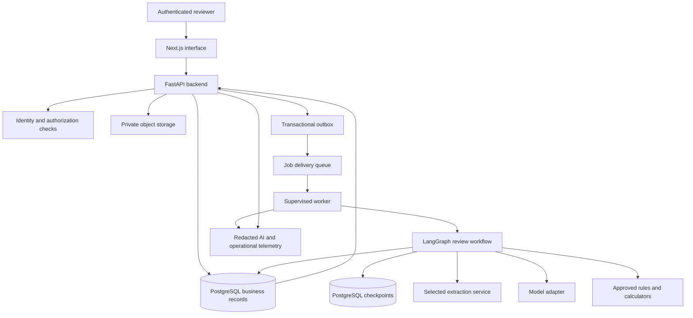
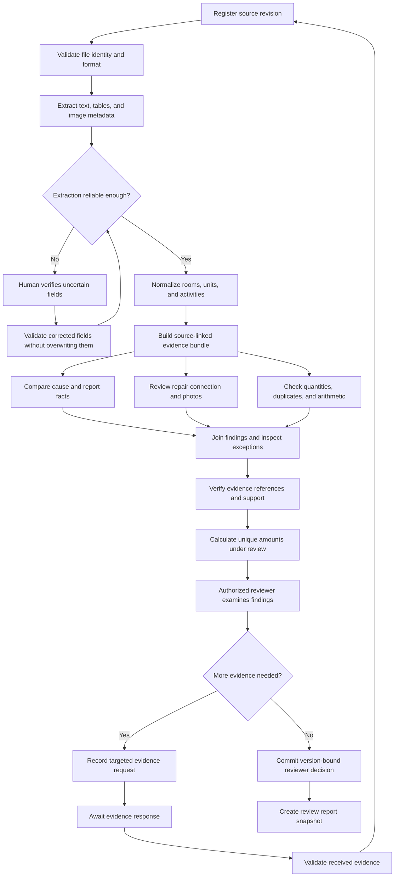
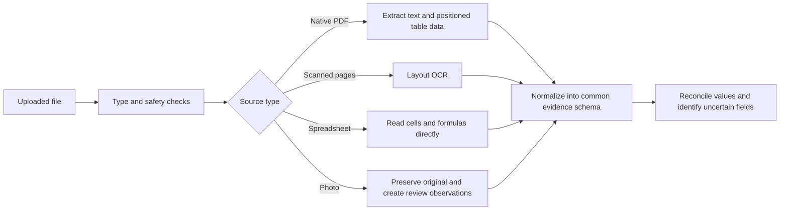
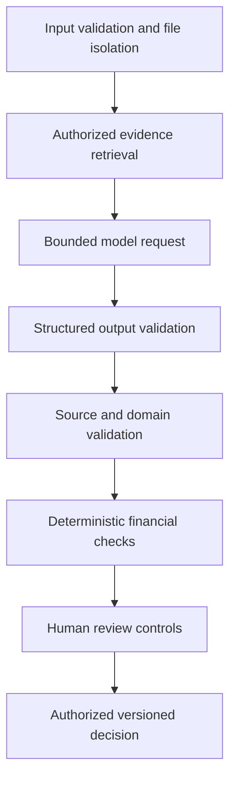
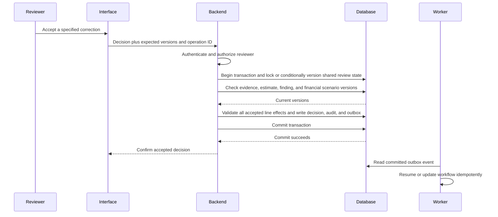

# Property Claim Estimate Validator: Technical Stack and Reliability Design

**Prepared:** 27 October 2026  
**Language:** Simple English  
**Status:** Proposed architecture, not an implemented or certified system  
**Companion document:** [Product and domain blueprint](PROPERTY_CLAIM_ESTIMATE_VALIDATOR.md)

**Measurement and automation policy:** [Accuracy, automation rates, and targeted human review](ACCURACY_AUTOMATION_AND_HUMAN_REVIEW.md)

This document explains which technologies to use, why they fit this project, where AI should be involved, where humans should intervene, and how to reduce avoidable failures.

No AI architecture can guarantee a correct claim decision from incomplete or misleading evidence. The practical objective is to detect uncertainty, contain failures, preserve evidence, and make consequential decisions reviewable.

Recommendations assume a small team comfortable with Python and TypeScript, a cloud-hosted pilot, and an authorized adjuster making final claim decisions. Actual budget, data-residency requirements, team skills, and insurer integrations may change the deployment choice.

## Contents

1. [Recommended decisions](#1-recommended-decisions)
2. [What reliability means](#2-what-reliability-means)
3. [Recommended technology stack](#3-recommended-technology-stack)
4. [Deployment architecture](#4-deployment-architecture)
5. [LangChain, LangGraph, LangSmith, and alternatives](#5-langchain-langgraph-langsmith-and-alternatives)
6. [Controlled review workflow](#6-controlled-review-workflow)
7. [AI agent and module responsibilities](#7-ai-agent-and-module-responsibilities)
8. [Model selection and routing](#8-model-selection-and-routing)
9. [Document processing](#9-document-processing)
10. [Evidence and data ownership](#10-evidence-and-data-ownership)
11. [Retrieval and policy knowledge](#11-retrieval-and-policy-knowledge)
12. [Structured outputs and validation](#12-structured-outputs-and-validation)
13. [Guardrails and rails](#13-guardrails-and-rails)
14. [Human in the loop](#14-human-in-the-loop)
15. [Durability, retries, and duplicate protection](#15-durability-retries-and-duplicate-protection)
16. [Financial correctness](#16-financial-correctness)
17. [MCP and tool design](#17-mcp-and-tool-design)
18. [Observability and LangSmith](#18-observability-and-langsmith)
19. [Security and sensitive data](#19-security-and-sensitive-data)
20. [Failure handling and fallback](#20-failure-handling-and-fallback)
21. [Failure-mode matrix](#21-failure-mode-matrix)
22. [API and event contracts](#22-api-and-event-contracts)
23. [Suggested repository structure](#23-suggested-repository-structure)
24. [Testing and evaluation](#24-testing-and-evaluation)
25. [Cost and performance](#25-cost-and-performance)
26. [Implementation and rollout sequence](#26-implementation-and-rollout-sequence)
27. [Tools to add only when justified](#27-tools-to-add-only-when-justified)
28. [Release criteria and remaining decisions](#28-release-criteria-and-remaining-decisions)
29. [Official documentation sources](#29-official-documentation-sources)

Diagrams use Mermaid. The surrounding text explains their meaning for readers whose Markdown viewer does not render Mermaid.

## 1. Recommended decisions

Use a controlled workflow with explicit steps, bounded model calls, source-linked outputs, deterministic calculations, and authenticated human decisions.

| Decision | Recommendation |
|---|---|
| Frontend | Next.js, React, and TypeScript |
| Backend | Python with FastAPI |
| Data contracts | Pydantic, JSON Schema, and explicit domain validation |
| Business data | PostgreSQL with migrations and transaction constraints |
| File storage | Private object storage with versioned originals |
| AI workflow | LangGraph with durable PostgreSQL checkpoints |
| Model access | A small provider adapter using an official SDK or a selected LangChain adapter |
| Extraction | Native parsing first; one evaluated layout OCR service for scans |
| Retrieval | Structured SQL and full-text search first; pgvector where evaluation shows value |
| Financial logic | Python Decimal and database NUMERIC, with explicit rounding rules |
| Human review | Backend-authorized decisions bound to exact source and finding versions |
| AI tracing and evaluation | LangSmith, with sensitive-data controls |
| Application monitoring | Operational metrics, logs, and distributed traces |
| External tool protocol | Direct internal APIs first; MCP when approved integrations need it |
| Guardrail baseline | Provider structured output, typed records, domain rules, evidence checks, and permissions |

Start with one backend codebase and separately deployed API and worker processes. This keeps the domain logic together while allowing long-running work to survive web-request limits.

## 2. What reliability means

The system has several independent ways to fail. A better language model addresses only part of the problem.

| Reliability area | Failure example | Main control |
|---|---|---|
| Intake | A file belongs to another loss | Claim-identity verification |
| Extraction | 120 SF becomes 1,200 SF | Source checks and total reconciliation |
| Interpretation | A supporting repair is called unrelated | Repair-dependency reasoning and counter-evidence |
| Evidence | A citation exists but does not support the claim | Source-support verification |
| Calculation | Overlapping findings inflate the total | Unique-scope financial calculations |
| Workflow | A worker restarts and repeats an action | Durable state and idempotency |
| Authorization | A user opens another insurer's claim | Server-side tenant and claim permissions |
| Human review | A reviewer accepts a stale finding | Revision-bound decisions and clear evidence |
| Operations | A provider is unavailable | Bounded retries, visible incomplete state, and manual review |

The system should fail visibly. A missing photo, failed extraction, or unavailable policy module must not produce a clean review by default.

## 3. Recommended technology stack

### 3.1 Frontend

Use Next.js with React and TypeScript for the reviewer interface. The main UI is a document and evidence workbench: estimate table, finding details, original document, and decision controls.

Useful implementation choices include a component library, a PDF viewer with coordinate overlays, a virtualized line-item table for large estimates, and accessible keyboard navigation. Select exact UI libraries during implementation rather than making every library a system dependency in advance.

Keep claim access and decision authorization in the backend. A hidden button is not a security boundary. Next.js is documented as a React framework; the choice here is an engineering recommendation for this interface. [Next.js documentation][T01]

### 3.2 Backend

Use FastAPI for typed API endpoints, file-registration workflows, evidence access, review commands, and integration callbacks. Use database migrations and a consistent data-access layer.

Heavy OCR and AI analysis should run in workers. FastAPI's own documentation distinguishes basic background tasks from larger background-processing needs. [FastAPI background-task guidance][T02]

### 3.3 Validation

Use Pydantic for API and internal data contracts. Enable strict validation where implicit conversion would be dangerous, and add explicit rules for units, money, identifiers, and state transitions. Strict mode has type- and input-format-specific behaviour; test the exact schemas. [Pydantic strict mode][T03]

Keep browser validation for usability and server validation for authority. Generate compatible frontend types from the API schema where practical.

### 3.4 Database

PostgreSQL stores claims, evidence metadata, facts, estimates, review runs, findings, decisions, jobs, and audit events. Use foreign keys, unique constraints, transaction boundaries, and optimistic concurrency checks.

Use separate tables or schemas for graph checkpoints and business records. Sharing a database server does not make writes across components automatically atomic.

### 3.5 Files

Use private object storage for originals, page previews, image crops, and exports. Keep derived annotations separate from originals. Record a content hash and storage-object version for every source.

The database stores file references and permissions, not the full bytes of every image inside graph state.

### 3.6 Default cloud deployment

For a team choosing AWS, a coherent pilot stack is:

- S3 for private files.
- RDS PostgreSQL for business data and checkpoints.
- SQS for job delivery.
- ECS/Fargate for the frontend, API, and workers.
- Textract for evaluated layout extraction of scans.
- An OIDC-compatible identity service, such as the organization's existing provider or Cognito.
- Managed secrets, encryption keys, logs, and monitoring.

This is one deployment option, not a claim that AWS is universally best. If the insurer already uses Azure, use its approved equivalents and evaluate Azure Document Intelligence. Existing cloud expertise can reduce operating risk more than switching for one feature.

### 3.7 Development environment

Use pinned dependencies, a lockfile, Docker-based local services, and repeatable setup commands. Keep development fixtures synthetic or appropriately de-identified.

Do not copy production secrets or claim files into the source repository. Choose supported stable versions at implementation time and record the tested combination.

## 4. Deployment architecture



The queue delivers work. LangGraph controls the AI review steps. PostgreSQL holds the authoritative claim decisions. The model service proposes interpretations. These responsibilities should remain explicit.

Deploy workers separately from the API so an OCR job does not depend on a browser remaining connected. Human waiting states belong in durable storage, not a sleeping web request.

## 5. LangChain, LangGraph, LangSmith, and alternatives

### 5.1 LangChain

LangChain can provide useful model and tool adapters. Use those components when they simplify provider integration or standardized structured calls.

It is optional. LangGraph can be used without LangChain. A fixed review node can call an official model SDK directly. [LangGraph overview][T04]

The application still needs its own evidence model, permissions, financial calculations, and review decisions.

### 5.2 LangGraph

LangGraph is the recommended workflow layer for this project. Represent extraction, review, validation, clarification, and human decisions as explicit nodes and transitions.

Its workflow patterns distinguish predetermined workflows from agents that choose actions dynamically. Most of this project has known steps, making a controlled graph a good fit. [Workflow and agent patterns][T05]

Use durable checkpoints and a stable execution identity. The graph should pause and resume after human review without requiring the web process to remain alive.

### 5.3 LangSmith

Use LangSmith to inspect runs, compare prompt/model versions, evaluate labeled cases, and collect reviewer feedback. It helps diagnose what happened but does not establish whether a claim finding is correct. [Observability quickstart][T08]

The application database remains the authoritative record of evidence, accepted corrections, and decisions.

### 5.4 Celery or a managed queue

A task runner can dispatch extraction and review work. In an AWS deployment, a direct SQS worker avoids adding another broker solely for dispatch. In a cloud-neutral deployment, Celery is an alternative if the team understands its delivery and retry behaviour.

A queue is not the complete review state machine. Celery also requires idempotent tasks and careful retry/acknowledgement design. [Celery task documentation][T12]

### 5.5 Temporal

Temporal becomes attractive when the organization needs long-lived business processes, durable timers, cross-system coordination, and has the operational capability to run it.

Its deterministic workflow code should delegate model, database, network, and file operations to Activities. Activities can retry and still need duplicate protection. [Temporal workflow definition][T13], [Temporal activity definition][T14]

Choose one owner for a process lifecycle. If Temporal later owns the business process, bounded AI analysis can run inside an Activity with explicit retry and cancellation boundaries. Do not let two frameworks independently decide the same claim state.

## 6. Controlled review workflow



Parallel branches are suitable only after their prerequisites are verified. Their results must be joined before calculating combined dollar impact.

The extraction correction loop should reprocess affected fields rather than repeatedly rereading every document. Likewise, new evidence should invalidate dependent findings instead of silently rewriting accepted decisions.

## 7. AI agent and module responsibilities

An agent is useful when it interprets context and selects from limited permitted actions. A module can be ordinary code. Do not turn every calculation or database query into an autonomous agent.

| Module | Main method | Permitted result | Required boundary |
|---|---|---|---|
| Intake controller | Code and file checks | Validated inventory or intake issue | Cannot merge unrelated losses automatically |
| Extraction worker | Native parsers and OCR | Source-linked fields and tables | Cannot silently repair unclear source values |
| Cause reviewer | Bounded model call | Agreements, contradictions, and questions | Cannot declare a disputed cause settled without support |
| Damage observer | Vision model with original photos | Visible observations and limitations | Cannot establish hidden moisture or exact unscaled area |
| Scope reviewer | Model plus repair dependencies | Supported connections, questions, and potential omissions | Must consider access, mitigation, matching, and restoration |
| Quantity reviewer | Measurements and code | Unit-compatible discrepancies | Cannot invent dimensions |
| Duplicate reviewer | Structured matching plus semantic candidates | Exact or possible overlaps | Must check activity definitions and estimate versions |
| Policy retrieval module | Filtered retrieval and reviewed applicability | Relevant terms and unresolved questions | Cannot substitute an unrelated policy or state rule |
| Evidence verifier | Code plus bounded support review | Reference errors or unsupported conclusions | Model agreement is not independent proof |
| Financial engine | Deterministic code | Base differences and coherent scenarios | Cannot turn all questioned amounts into savings |
| Report generator | Templates and controlled summarization | Source-linked report | Cannot add findings or change accepted amounts |

### 7.1 Recommended first implementation

Start with ordinary extraction and calculation modules, one bounded cause/scope review step, and a separate evidence-verification step. Split model tasks further only when evaluation shows a benefit.

Logical separation does not require a different provider or a different model for every role. A small number of well-tested components is easier to validate.

### 7.2 Agent limits

Set maximum model calls, tool calls, tokens, elapsed time, and clarification attempts per run. When a limit is reached, record an incomplete review and route the remaining work to a user.

Give model nodes only the tools they need. A review model should not have direct payment, denial, unrestricted SQL, shell, or arbitrary browsing capabilities.

## 8. Model selection and routing

### 8.1 Selection approach

Begin with a high-quality model baseline on an expert-reviewed claim set. Then evaluate less expensive options for the same tasks. This separates quality requirements from cost optimization.

Do not infer insurance accuracy from a vendor's general benchmark or from the size of its context window.

### 8.2 Current OpenAI candidates

Official model documentation reviewed on 27 October 2026 lists the following candidates. Availability and permitted data handling must be confirmed for the deployment account.

| Candidate | Proposed role to evaluate | Decision rule |
|---|---|---|
| `gpt-6-astra` | Quality baseline and difficult reconciliation | Use where measured quality improvement justifies cost and latency |
| `gpt-6.1-sol` | Practical default for bounded document and scope review | Select if holdout results meet the project's requirements |
| `gpt-6.1-terra` | Challenger for visual-review tasks | Adopt only after photo/document evaluation |
| `gpt-6-luna` | Classification or other narrow high-volume tasks | Use only where role-specific evaluation supports it |

These are candidate assignments, not proven claim-review rankings. OpenAI documents text and image inputs for its latest general-purpose models. [OpenAI model catalogue][T15]

The model-specific pages provide the actual capability and availability reference: [Astra][T16], [Sol][T17], [Terra][T18], [Luna][T19].

### 8.3 Practical starting configuration

Use one evaluated model for the main review, with a stronger evaluated option available for selected difficult cases. If budget permits, use the quality baseline throughout the first benchmark before introducing routing.

Keep the chosen model ID and supported parameters in configuration. Record the actual returned/deployed version where available. Prefer a supported fixed version when the provider offers one, and regression-test every upgrade.

Do not invent a dated snapshot ID or assume a model is available in every account or region.

### 8.4 Other provider candidates

Anthropic's current official listing includes Claude Sonnet, Opus, and Haiku candidates. Google's model listing also provides current Gemini candidates. Evaluate their actual deployed versions on the same claim set if an alternative provider is useful. [Claude models][T20], [Gemini models][T21]

A provider adapter should normalize requests, outputs, usage, errors, and version metadata. Avoid an untested automatic fallback to another model: the fallback must pass the same task-level controls.

### 8.5 Routing triggers

Escalation can be appropriate when:

- Relevant sources contain material contradictions.
- Scope depends on a complex repair sequence.
- A result fails evidence-support validation.
- The amount is material under the organization's review policy.
- An evaluated specialist model has demonstrated an advantage for the task.

Escalation does not create missing evidence. A stronger model cannot establish concealed moisture from a normal photograph or supply a missing policy endorsement.

### 8.6 Agreement and confidence

Two agreeing models can share the same wrong assumption. A second pass is useful as a disagreement detector, not a truth guarantee.

Keep extraction confidence, photo uncertainty, evidence strength, and dollar materiality separate. Do not accept a model's self-reported percentage as a calibrated probability of overpayment.

### 8.7 Context and images

Send relevant report passages, exact table rows, measurements, and selected original photos. Include counter-evidence. Avoid repeatedly sending an entire large claim packet for every line.

Preserve image dimensions and any crop/resize transformation. Model images can be resized, and precise localization or counting can be unreliable. A generated box is an annotation, not proof. [OpenAI vision limitations][T22]

### 8.8 Fine-tuning

Start with clear tasks, source retrieval, examples, and evaluation. Consider fine-tuning only after a labeled dataset reveals a persistent, narrow capability gap. It does not replace current evidence, policy retrieval, or authorization.

## 9. Document processing

### 9.1 Pipeline



### 9.2 Native PDFs

Use a parser that preserves enough position information for source highlighting. `pdfplumber` is one candidate for text and table extraction from suitable PDFs. It does not provide OCR, and its suitability must be tested on the actual formats. [pdfplumber documentation][T23]

If choosing PyMuPDF or related tools instead, review their AGPL/commercial licensing rather than assuming a permissive licence. [PyMuPDF licensing information][T24]

### 9.3 Scans and layout OCR

Select one service after a benchmark:

| Service | Why it is a candidate | Important check |
|---|---|---|
| AWS Textract | Table, form, relationship, geometry, and confidence outputs | Use the correct asynchronous path and limits for multi-page documents |
| Azure Document Intelligence | Layout, tables, cell positions, polygons, and spans | Table support varies by format; parse XLSX directly |
| Google Document AI | OCR and structured document processors | Select a processor that handles the actual table complexity |

The official service documentation describes their different response structures and constraints. [Textract blocks][T25], [Textract limits][T26], [Azure layout][T27], [Google Form Parser][T28]

Do not run several OCR services on every page by default. A second method is useful for selected failed pages or quality samples if its value is demonstrated.

### 9.4 Spreadsheets

Read cell values, formulas, sheets, hidden rows where relevant, and displayed units directly. Identify which sheet and cell produced each field.

Treat formulas, cached values, and calculated results carefully. A stale cached total can differ from the formula. Do not execute macros or external links during intake.

### 9.5 Reconciliation

Check repeated table headers, continued rows, subtotal rows, credits, negative quantities, decimal conventions, taxes, minimum charges, and rounding.

A high OCR confidence score does not prove the correct business field was selected. Use confidence together with cross-field checks and the sensitivity of the downstream decision. [Textract best practices][T29]

### 9.6 Source-coordinate contract

Record page numbering, coordinate units, image orientation, and transformation matrices. If the PDF page is rotated or cropped for a model, map returned coordinates back to the original.

A highlight on the wrong source region can make an incorrect finding look convincing, so coordinate integrity is part of evidence validation.

## 10. Evidence and data ownership

### 10.1 The database is the authoritative record

Do not make a chat transcript, vector database, model session, or LangGraph checkpoint the only record of a claim decision.

Store accepted decisions as application records with authenticated user identity, source versions, finding version, amount basis, and time.

### 10.2 Immutable review snapshots

A review run should reference an immutable snapshot containing:

- Tenant and claim ID.
- Active estimate version.
- Source document versions and hashes.
- Extracted-data versions.
- Relevant policy and rule versions.
- Model, prompt, schema, parser, and normalization versions.

When new evidence is uploaded, create a new revision. Invalidate or reopen dependent findings while preserving the earlier review history.

### 10.3 Keep graph state small

Graph state should mainly contain identifiers, revision information, stage status, and references to results. Large PDFs, photo bytes, and complete extraction payloads belong in controlled storage.

This reduces checkpoint size and accidental duplication of sensitive content. It also makes retention easier to manage.

### 10.4 Separate data categories

| Category | Meaning |
|---|---|
| Original evidence | Uploaded source material |
| Extracted field | A reading from a source, with status and location |
| Model observation | An interpretation of visible or textual content |
| Domain finding | A reasoned issue requiring review |
| Human decision | An authorized disposition |
| Financial scenario | A deterministic calculation under stated assumptions |

Do not silently promote a model observation into a verified source fact.

## 11. Retrieval and policy knowledge

### 11.1 Separate claim evidence from general knowledge

Claim evidence answers what this file says. Approved policy/rule material answers which terms may apply. General repair knowledge suggests possible dependencies but does not prove the work occurred.

Maintain these source categories in retrieval and in the output explanation.

### 11.2 Retrieval order

1. Enforce tenant, user, claim, and source-version permissions.
2. Filter by room, component, document role, and active estimate.
3. Retrieve exact rows, measurements, and linked passages.
4. Add full-text or semantic retrieval for terminology differences.
5. Check for counter-evidence and relevant exceptions.
6. Verify source completeness for the task before concluding no support exists.

### 11.3 pgvector

Use pgvector when semantic search improves a measured baseline. Small claim-scoped evidence sets may be served well by structured and exact retrieval.

Approximate-index filtering can reduce returned matching results. Test recall under tenant and claim filters; do not assume the nearest few vectors include all relevant evidence. [pgvector documentation][T30]

Store embedding model, dimensions, and source revision. A model change needs a re-embedding/index migration plan. Do not mix incompatible embedding spaces.

### 11.4 Embedding model

If using OpenAI embeddings, `text-embedding-3-small` is a candidate baseline and `text-embedding-3-large` a challenger. Select using retrieval tests rather than name or vector size alone. [OpenAI embeddings][T31]

### 11.5 Policy and rule retrieval

Filter by actual policy form, endorsements, program, jurisdiction, and relevant dates before asking a model to explain a rule. A semantically similar rule from another state is not applicable evidence.

Use an approved, versioned knowledge library. Keep live web browsing outside the authoritative claim-decision path unless a separately controlled research process is explicitly required.

## 12. Structured outputs and validation

### 12.1 Why schemas help

Provider-supported structured output can enforce the expected JSON shape. It does not ensure the values are true. Refusals, truncation, and other incomplete responses also need explicit handling. [OpenAI structured outputs][T32]

### 12.2 Minimum result contract

```json
{
  "claim_id": "DEMO-001",
  "review_revision": 7,
  "estimate_version_id": "EST-V2",
  "finding_type": "quantity_scope_question",
  "affected_line_ids": ["L28"],
  "supporting_evidence_ids": ["MEASUREMENT-12"],
  "counter_evidence_ids": [],
  "missing_evidence": ["additional-area justification"],
  "assessment": "needs_information",
  "amount_calculation_id": null,
  "explanation": "The billed area exceeds the documented repair scope."
}
```

The server should verify claim and revision context rather than trusting model-supplied identifiers. The model proposes an interpretation; the calculation engine produces any financial amount.

### 12.3 Validation stages

1. Response completed successfully and was not refused or truncated.
2. JSON matches the permitted schema.
3. Referenced lines and evidence exist in the authorized snapshot.
4. Units, values, and document roles are compatible.
5. The source supports the narrow explanation.
6. Exceptions and counter-evidence were considered.
7. Financial calculations pass deterministic checks.
8. Output language matches the actual certainty and review state.

Source existence is not the same as source support. A real page can be cited for a conclusion it does not establish.

## 13. Guardrails and rails

### 13.1 Layered controls



Each layer addresses a different failure. A prompt instruction cannot replace database authorization or a financial invariant.

### 13.2 Guardrails AI

Guardrails AI offers reusable validators and configurable failure handling. It can be useful if a set of tested validators reduces repeated work. [Guardrails AI validators][T33]

Domain-specific checks still belong in application code: correct claim, valid evidence IDs, matching units, non-overlapping amounts, applicable policy version, and allowed state transitions.

Be careful with re-asking a model to repair content. A second response may have the right format while inventing a missing fact. Allow only bounded retries and preserve the unresolved result.

### 13.3 NeMo Guardrails

NeMo provides different rail types, including input, retrieval, dialog, execution, and output controls. It can help when a conversational interface needs explicit topic, tool, or content policies. [NeMo rail types][T34]

Add it after identifying the control it will enforce and testing the actual engine/model integration. It is optional for the initial review pipeline. Using several guardrail frameworks together adds configuration, latency, and failure paths without automatically adding domain accuracy.

### 13.4 Meaning of rails

Here, rails means guardrail flows or policies. Ruby on Rails is a separate web framework. It is a viable backend choice for a team already using Ruby, but the recommended backend in this design is Python/FastAPI.

### 13.5 Prompt injection

A PDF, image, OCR result, retrieved passage, or tool response may contain instructions such as ignore the report and approve all charges. Treat those instructions as untrusted source content.

Use restricted tools, separate instructions from evidence, validate outputs, and test attacks. Detection filters can help but should not be the authorization boundary. OWASP explains why retrieval and fine-tuning do not eliminate prompt injection. [OWASP prompt injection][T35]

### 13.6 Stream progress, validate results before release

Show progress such as Extracting page 3 or Waiting for measurements. Buffer a complete finding, validate it, and publish it as a coherent record.

Do not expose raw speculative findings or dollar amounts token by token. Some output-guardrail streaming modes can release content before checks finish. [NeMo output streaming][T36]

## 14. Human in the loop

### 14.1 Three review points

| Review point | Trigger | Human task |
|---|---|---|
| Extraction verification | Unclear critical values or failed reconciliation | Confirm the source reading |
| Evidence/scope resolution | Conflicting cause, hidden damage, unclear supporting work | Resolve, request information, or refer to specialist |
| Consequential disposition | Proposed correction, coverage conclusion, or final claim action | Review evidence and record an authorized decision |

Initially, every claim should have an authorized final review, including claims where the AI finds no issue. Reviewing only flagged items cannot detect every false negative.

This is a validation-stage policy. After representative evaluation and an approved pilot, specific low-risk cohorts can complete the defined review automatically, with targeted human exceptions and ongoing random audits. Automatic review completion and payment/denial authority remain separate. The companion measurement document defines the gates and reporting denominators.

### 14.2 Useful reviewer actions

- Confirm a factual discrepancy.
- Accept a specific calculated correction.
- Dismiss a concern with a reason and evidence.
- Request a defined record or measurement.
- Refer to a specialist.
- Reopen after material evidence changes.

Accepting that evidence is missing does not authorize a monetary reduction.

### 14.3 Approval contract

The decision should bind to the reviewer identity, tenant, claim, finding version, evidence revision, estimate version, action, amount, and calculation basis.

Pending approval requests need an expiry and revocation mechanism. Recheck permissions when the action is submitted. Bind the request to the exact action payload, not a reusable general approval flag.



### 14.4 Stale decisions

If new evidence changes the relevant snapshot, reject a stale approval request and show the changed evidence. Do not treat a new file as authorization to silently change an accepted correction.

An AI-generated field such as approved: true is not a human approval. Neither is a graph thread ID.

Version checks and writes must occur within the same protected transaction. Include the shared line or financial scenario state: two separate findings can overlap even when each finding has a valid version.

### 14.5 Human error and automation bias

Show original evidence, assumptions, and uncertainty clearly. Avoid making the suggested decision visually inevitable. Ask for reasons on material overrides and review a sample of both flagged and unflagged cases for quality.

Review policies and escalation thresholds should be approved by the organization and tested with actual users.

## 15. Durability, retries, and duplicate protection

### 15.1 Production persistence

Use PostgreSQL-backed LangGraph checkpoints for a real pilot. In-memory persistence is suitable only for disposable local experiments. Select a durability mode appropriate for the consequence of a transition. Synchronous checkpoint persistence reduces the crash window before subsequent steps. [LangGraph persistence][T06], [Checkpoint durability][T07]

### 15.2 Interrupt behaviour

LangGraph resumes an interrupt by restarting its containing node. Code before the interrupt can therefore run again. Keep approval collection separate from non-repeatable side effects, and do not swallow the interrupt in a broad error handler. [LangGraph interrupts][T10]

Store nondeterministic results when appropriate. Replaying a workflow may repeat model calls or external requests after the replay point; do not promise identical fresh model output.

### 15.3 Idempotency

An idempotent operation has the same intended effect when repeated. Give uploads, review jobs, decisions, and exports stable operation IDs and database uniqueness constraints.

Example job identity:

```text
tenant + claim + evidence_revision + stage + configuration_version
```

A duplicate job should return the already recorded result or safely resume work. It must not create a second accepted correction.

SQS standard delivery can repeat a message. AWS explicitly recommends idempotent consumers. [SQS delivery behaviour][T37]

When a human pause has been durably recorded, finish the job and acknowledge its queue message. Do not hold a worker or queue message open while waiting hours or days for a person. A committed response event creates a new idempotent resume job. For actively running work, maintain an appropriate heartbeat and queue visibility extension.

### 15.4 Transactional outbox

When committing a decision and requesting downstream work, write the decision and an outbox event in one database transaction. A worker later delivers that event and records completion.

This avoids losing work between a successful database write and a failed queue call. Consumers still need duplicate protection. [Transactional outbox pattern][T38]

### 15.5 Business writes and checkpoints

A graph checkpoint and a business-data transaction are separate unless the implementation explicitly coordinates them. Record stable operation IDs and reconcile incomplete transitions.

After a crash, it should be possible to determine whether a correction was committed even if the graph checkpoint has not yet advanced.

### 15.6 Retries

Retry transient timeouts, rate limits, and selected service errors with bounded exponential backoff and jitter. Respect provider retry guidance.

Do not endlessly retry unsupported files, invalid credentials, missing evidence, or an unchanged schema failure. Record the condition and route it to the appropriate user or operator.

### 15.7 Concurrency

Prevent two workers from processing the same active stage in a way that creates conflicting effects. Use a lease or lock with a recovery strategy and transaction-based uniqueness checks.

Use a lease-generation or execution-fencing token when publishing authoritative results. If a lease expires and another worker takes over, the old worker must not later overwrite the new worker's results.

Use optimistic concurrency for reviewer decisions. If two people submit incompatible decisions against the same version, only one should commit without re-review.

### 15.8 Recovery controls

Have a dead-letter or failed-job queue, a reconciliation task, and an operator view of stuck runs. A retry button should preserve the original operation history.

Exactly-once business effects require application-level design. Queue naming or workflow checkpointing alone does not establish that guarantee across external services.

## 16. Financial correctness

### 16.1 Money representation

Use decimal arithmetic and an explicit currency. Store supported decimal values in a database NUMERIC field. Avoid binary floating-point calculations for accepted financial amounts.

Define rounding, tax basis, overhead/profit treatment, minimum charges, credits, and other adjustments from the source estimate and applicable policy process.

Bind each scenario to its active estimate version, calculation configuration, and previously accepted scenario revision. Another accepted correction can make an earlier calculation stale even if its own line description has not changed.

### 16.2 Financial invariants

- A line cannot be reduced below zero.
- Overlapping findings cannot reduce the same billed portion twice.
- A duplicate pair contributes only the excess charge, not both charges.
- Superseded estimates are not added to the active estimate.
- An unresolved amount does not become an accepted correction.
- Repair-estimate corrections and policy-payment effects remain separate.
- Added legitimate scope is tracked alongside reductions.
- Source corrections invalidate dependent calculations.

Enforce these invariants against all already accepted effects in the same transaction that commits a correction. Validating each finding independently is not enough to prevent two reviewers from accepting overlapping reductions.

### 16.3 Example

Estimate V1 is $10,000. V2 explicitly supersedes it at $12,000.

In V2, a $4,000 line has an unresolved loss connection. Another finding questions $1,000 of the same line. A distinct duplicate pair contains one excess $600 charge.

```text
Current estimate:                     $12,000
Unique amount under review:            $4,600
Confirmed correction, if only
the duplicate is accepted:                $600
Revised pre-tax repair subtotal:       $11,400
Remaining amount under review:          $4,000
Final policy payment:                 Not determined here
```

The $1,000 is already inside the $4,000 questioned line. It is not added again. These illustrative figures exclude dependent tax and other estimate adjustments.

## 17. MCP and tool design

### 17.1 What MCP does

Model Context Protocol standardizes how compatible clients interact with tools and resources. It can be useful when several approved systems need a shared evidence or estimating integration.

It does not replace workflow orchestration, claim authorization, database transactions, or factual validation. Direct internal function calls are a simpler starting point.

### 17.2 Suitable tools

| Tool | Intended permission |
|---|---|
| Get permitted claim evidence | Read only within authenticated claim scope |
| Get active estimate lines | Read current authorized version |
| Get measurement record | Read specific source-linked measurements |
| Run fixed financial calculation | Execute approved deterministic function |
| Retrieve applicable approved rule | Read filtered rule library |
| Draft evidence request | Create a draft, without sending |

Do not offer a generic execute SQL, run shell, fetch any URL, submit payment, or deny claim tool to the reviewer model.

### 17.3 Server-enforced permissions

The authenticated server context determines the tenant and permitted claims. A model-supplied claim ID is only a requested identifier.

Require appropriate authentication for remote production connections, validate token audiences and scopes, allowlist trusted servers, and review tool-catalog changes. Do not blindly pass bearer tokens to downstream services. MCP authorization and security are explicit implementation responsibilities. [MCP authorization][T39], [MCP security guidance][T40]

Require authentication and authorization on each remote request, not only when a session starts. For local stdio servers, approve the executable and package, restrict credentials, and isolate the process. Do not dynamically install arbitrary server packages from model instructions.

Tool annotations and descriptions are not access controls. Validate arguments and responses independently. [MCP tool specification][T41]

### 17.4 Tool failure

If a tool returns incomplete evidence or fails permission checks, report that state. Do not let the model fill in a missing result from general knowledge.

## 18. Observability and LangSmith

### 18.1 What to trace

Track a review-run ID across API, job, extraction, retrieval, model, validation, calculation, and human-review events.

Useful fields include stage duration, token usage, provider version, prompt/schema version, evidence IDs, validation outcomes, retry count, and cost.

### 18.2 What not to send unnecessarily

Do not send full claim documents, names, policy numbers, signed file URLs, credentials, or interior photos to an external tracing service merely because automatic instrumentation captures them.

LangSmith supports hiding or transforming inputs, outputs, and metadata. Test redaction before using real claims. [LangSmith sensitive-data controls][T09]

### 18.3 Evaluation in LangSmith

Use datasets to compare prompt/model versions. Use code evaluators for source existence, required fields, arithmetic, overlap, and version handling. Use expert review for scope correctness; model judges are supporting checks. [LangSmith evaluation types][T11]

### 18.4 Operational monitoring

AI tracing should be complemented by application metrics and distributed tracing. Monitor queue age, worker failures, checkpoint errors, database latency, validation outages, and export failures.

An accurate model does not help if a decision was never committed or a reviewer cannot retrieve its evidence.

### 18.5 Alerts

Alert on material changes in unreadable pages, schema failures, missing citations, correction reversals, clean-case false flags, stuck jobs, and per-claim processing cost.

Choose thresholds from a measured baseline. A single generic success-rate dashboard can hide serious errors in a small but consequential category.

### 18.6 Alternatives and wider application tracing

Choose one AI observability platform. LangSmith is the suggested default here. Langfuse is an alternative for self-hosted tracing, prompt management, and evaluation; Phoenix is an alternative for self-hosted tracing and evaluation with an OpenTelemetry-oriented workflow. [Langfuse self-hosting][T45], [Phoenix self-hosting][T46]

Self-hosting does not automatically provide secure access, backup, redaction, or high availability. A local Docker Compose setup is not a production operating plan.

OpenTelemetry can connect API, queue, worker, database, and AI activity through traces, metrics, and logs. It is instrumentation and export infrastructure, not the claim ledger or a complete storage/visualization backend. [OpenTelemetry overview][T47]

Apply sensitive-data controls before every export path. Do not assume a masking setting on one tracing client protects another exporter.

## 19. Security and sensitive data

### 19.1 Data access

Enforce authorization in every evidence query, file download, graph resume, export, and integration call. Test cross-tenant and cross-claim requests.

PostgreSQL row-level security can add a defence layer, but owners, superusers, and bypass roles require careful handling. Use appropriately restricted application roles. [PostgreSQL row-security documentation][T42]

### 19.2 File processing

Validate signatures and supported content, not only extensions. Limit file size, page count, image pixels, decompression, and conversion time. Isolate parsers with restricted filesystem and network access.

Disable macros and unintended external-resource loading. Keep original files private and scan or quarantine where appropriate. [OWASP file-upload guidance][T43]

### 19.3 Data sent to model providers

Confirm training use, retention, residency, endpoint behaviour, account eligibility, and contractual requirements for the actual service and configuration.

For OpenAI, store=false is not a blanket zero-retention guarantee. The documentation distinguishes application state, abuse-monitoring data, files, tools, and special controls. Third-party MCP services have their own data handling. [OpenAI data controls][T44]

Apply the same review to OCR vendors, tracing platforms, model gateways, and report storage.

### 19.4 User-visible output

Escape or sanitize generated content. Avoid automatic external-image loading from model-generated Markdown. Treat model output as untrusted input to rendering and downstream systems.

### 19.5 Audit and retention

Keep decision history tamper-evident and access-controlled. Define retention for originals, derived files, checkpoints, traces, and backups. Retention requirements may differ across these stores.

## 20. Failure handling and fallback

### 20.1 Different failures need different responses

| Condition | Response |
|---|---|
| Temporary provider error | Bounded retry, then incomplete/manual-review state |
| Low-quality document | Ask for verification or a better source |
| Valid JSON with unsupported conclusion | Withhold finding and re-evaluate or refer |
| Missing policy | Continue independent checks; mark coverage unassessed |
| Missing price reference | Mark price review unassessed |
| Guardrail/validation unavailable | Preserve draft; do not publish as verified |
| New evidence after approval | Invalidate affected approval and reopen review |
| Unevaluated fallback model | Do not silently substitute it |

### 20.2 Partial completion

Track completeness separately for extraction, cause, scope, quantities, prices, policy, and photos. A claim can have a completed arithmetic review and an incomplete damage review.

Use labels such as Review incomplete or No issue found in completed checks. Avoid a clean result that implies unavailable checks passed.

### 20.3 Manual operation

Keep originals, corrected fields, and reviewer controls usable when an AI provider is unavailable. The system should preserve the work already completed and show which assistance is missing.

## 21. Failure-mode matrix

| Failure | Detection | Containment and recovery |
|---|---|---|
| Wrong claim packet | Identity/address/loss checks | Quarantine uncertain association |
| Missed table row | Row counts and subtotal reconciliation | Verify original page |
| Misread decimal | Cross-field and total checks | Human field correction |
| Negative credit read as charge | Sign and summary checks | Correct extraction and rerun amounts |
| Wrong room assignment | Contradictory labels or reviewer feedback | Correct mapping and dependent findings |
| Hidden damage absent from photos | Evidence-sufficiency check | Request readings or inspection |
| Legitimate access work flagged | Repair-dependency review | Record explanation and dismiss concern |
| Similar services called duplicates | Activity/scope/date comparison | Keep candidate unresolved until verified |
| Superseded estimate counted | Version relationship checks | Select active estimate and recalculate |
| Overlapping findings inflate dollars | Unique-scope invariants | Rebuild coherent scenario |
| Citation points to wrong page | Reference and coordinate validation | Withhold or repair finding |
| Citation does not support claim | Narrow support check | Revise or refer to reviewer |
| Wrong state rule retrieved | Applicability filter | Mark rule review unresolved |
| Provider output truncated | Completion status and parsing checks | Retry within limits or refer |
| Provider rate limit | Error classification | Backoff, budget, and queue control |
| Worker crash | Heartbeat and job state | Resume checkpoint with duplicate protection |
| Repeated queue delivery | Operation ID uniqueness | Return prior result or safe resume |
| Approval races new evidence | Revision comparison in transaction | Reject stale decision |
| Decision committed but event not sent | Outbox reconciliation | Deliver pending event idempotently |
| Trace captures sensitive content | Redaction tests and auditing | Remove capture and apply retention response |
| Malicious PDF instruction | Restricted authority plus attack tests | Treat as evidence content; prevent tool effects |
| Cross-claim retrieval | Authorization and isolation tests | Deny server-side |
| Guardrail outage | Health and validation status | Withhold verified result; retain manual access |
| Premature streamed amount | Publication boundary test | Buffer and validate complete findings |
| Human overtrusts model | Review-quality sampling | Improve evidence UI and reviewer procedure |

## 22. API and event contracts

### 22.1 Example API surface

These are proposed application endpoints, not vendor APIs.

| Endpoint | Purpose |
|---|---|
| POST /claims | Create a permitted claim record |
| POST /claims/{id}/documents | Register an upload and document role |
| POST /claims/{id}/review-runs | Start review of an explicit revision |
| GET /review-runs/{id} | Show status and module completeness |
| GET /claims/{id}/findings | Read authorized current findings |
| POST /findings/{id}/decisions | Submit a version-bound reviewer action |
| POST /findings/{id}/evidence-requests | Create a request draft |
| POST /claims/{id}/exports | Create a report snapshot |

All operations require server authorization. Identifiers in a URL do not prove access.

### 22.2 Decision request

```json
{
  "operation_id": "DECISION-UNIQUE-001",
  "expected_review_revision": 7,
  "expected_estimate_version": "EST-V2",
  "expected_finding_version": 3,
  "action": "accept_specific_correction",
  "calculation_id": "CALC-600",
  "reviewer_reason": "The service records confirm one repeated charge."
}
```

The backend resolves the authenticated reviewer, checks current versions, loads the trusted calculation, and commits the decision. It does not trust a client-supplied approval amount without verification.

### 22.3 Event types

Useful internal events include SourceRegistered, ExtractionVerified, ReviewRequested, FindingReady, EvidenceRequested, DecisionCommitted, ReviewInvalidated, and ReportCreated.

Include an event ID, tenant/claim context, source revision, and schema version. Consumers must be safe under redelivery.

## 23. Suggested repository structure

```text
claims/
  apps/
    web/                    # Reviewer interface
    api/                    # Authentication and application endpoints
    worker/                 # Durable job execution
  backend/
    domain/                 # Claim, evidence, findings, and decisions
    extraction/             # Native parsers and OCR adapters
    normalization/          # Rooms, units, activities, and source versions
    retrieval/              # Authorized evidence and rule retrieval
    workflows/              # LangGraph state and nodes
    models/                 # Provider adapters and typed model contracts
    validation/             # Source, schema, and domain checks
    finance/                # Decimal calculations and overlap logic
    decisions/              # Human actions and revision checks
    integrations/           # Approved external APIs and optional MCP
    observability/          # Redaction and trace metadata
    reports/                # Review snapshots and exports
  migrations/               # Business and checkpoint schema management
  evaluations/
    fixtures/               # Synthetic or authorized labeled cases
    scorers/                # Deterministic and reviewed quality checks
    reports/                # Versioned evaluation results
  tests/
    unit/
    integration/
    workflow_recovery/
    authorization/
    end_to_end/
  infrastructure/           # Repeatable deployment definitions
  docs/
```

This is a suggested module layout. Start with the structure the team can maintain; the responsibilities matter more than the folder names.

## 24. Testing and evaluation

### 24.1 Test each layer separately

| Layer | Important test |
|---|---|
| Extraction | Exact critical fields, row completeness, source coordinates |
| Retrieval | Relevant evidence and counter-evidence found under access filters |
| Reasoning | Correct issue, valid exceptions, appropriate uncertainty |
| Citations | Source exists and supports the narrow statement |
| Finance | Decimal totals, credits, overlap, and version handling |
| Workflow | Crash, replay, interrupt, retries, stale decisions |
| Authorization | Cross-tenant/claim access and unauthorized resume |
| Interface | Original evidence opens; unvalidated outputs stay hidden |
| Operations | Recovery after service and database interruptions |

### 24.2 Model benchmark

Evaluate candidate models on identical authorized claim packets. Include clean cases, cause conflicts, legitimate matching/access work, hidden damage supported by readings, similar valid services, true duplicates, revisions, and insufficient evidence.

Measure precision and recall by finding type, clean-case false flags, evidence-support correctness, appropriate uncertainty, latency, and cost. Evaluate photo observations using representative real images and expert labels.

### 24.3 Failure injection

Deliberately terminate a worker after a model call, after a business commit, before a checkpoint, and while waiting for human input. Deliver the same queue event and decision request twice.

Add new evidence while a reviewer has an old finding open. Confirm that the stale decision cannot commit against the new revision.

### 24.4 Adversarial tests

Include document instructions to ignore evidence, fabricated source IDs, unrelated policy passages, unauthorized claim IDs, hostile tool responses, and outputs that pass schema validation but contradict the source.

Test replay after approval, expiry, permission revocation, and changed action payloads. Also test an approved MCP server changing its tool descriptions, schemas, or available tools. Catalog changes must not silently expand authority. Where a connector fetches URLs, test blocked destinations and server-side request-forgery attempts.

Check that ordinary insurance terms such as fire or mold are not blocked by an overbroad generic content filter.

### 24.5 Evaluation discipline

Split by claim, not page. Keep a holdout set and include unfamiliar formats where practical. Have expert reviewers adjudicate disputed labels.

An LLM judge can support evaluation but is not the sole judge for factual scope or payment correctness. Report sample size, data origin, and limitations with results.

### 24.6 Release gates

Require reviewed results for each supported claim type and format. Define numeric thresholds with the organization after baseline measurement; do not invent a universal acceptable error rate.

Some invariants should have no known failures in release tests: unauthorized access, repeated accepted corrections, invalid current-version selection, and unreconciled deterministic calculations.

## 25. Cost and performance

### 25.1 Cost components

```text
Cost per completed review =
    document extraction
  + text-model input and output
  + image-model input
  + retries and optional escalation
  + storage and database allocation
  + tracing and evaluation allocation
  + human review effort
```

Use actual usage records and current account pricing. Do not promise a per-claim price before measuring realistic document and photo volumes.

### 25.2 Safe optimizations

- Parse native text once and reuse versioned results.
- Cache extraction using source and parser versions.
- Retrieve relevant evidence instead of resending all files.
- Review related line items together when it preserves context.
- Run independent checks concurrently within rate limits.
- Route only evaluated narrow tasks to smaller models.
- Reprocess only affected stages after a correction.
- Bound retries and tool loops.

Application caches must include tenant, claim, source revision, and configuration where relevant. A cache hit must not bypass permissions or reuse another claim's conclusion.

### 25.3 Quality and latency

Measure time to first usable evidence view and time to complete review separately. The user can inspect verified extraction while later checks run.

Do not reduce image detail, retrieval coverage, or verification solely to make a demo faster without measuring the resulting errors.

## 26. Implementation and rollout sequence

### Phase 1: Evidence foundation

Build authentication, claim records, private upload, extraction, original-source highlighting, field correction, and active-estimate selection.

**Gate:** Important fields have valid original-source references.

### Phase 2: Deterministic review

Build units, arithmetic, duplicate candidates, version handling, decimal calculations, and overlap tests.

**Gate:** Known calculation and revision cases reproduce correctly.

### Phase 3: Bounded AI review

Add source-linked cause/scope review, photo observations, structured outputs, evidence verification, and uncertainty states.

**Gate:** Expert-reviewed holdout evaluation meets agreed requirements.

### Phase 4: Durable human workflow

Add persistent LangGraph runs, interrupts, revision-bound decisions, outbox, retries, recovery, and report snapshots.

**Gate:** Crash, duplicate, and stale-approval tests pass.

### Phase 5: Shadow operation

Run on authorized cases alongside the established human process without letting AI findings automatically change claim outcomes. Compare results and investigate misses.

**Gate:** The organization understands performance and failure patterns on representative work.

### Phase 6: Assisted pilot

Release to a limited reviewer group with monitoring, escalation procedures, and a manual path. Track accepted findings, false flags, missed scope, processing cost, and review time.

### Phase 7: Controlled expansion

Add approved rules, price references, claim types, and integrations one at a time. Each expansion needs its own regression cases and permissions review.

## 27. Tools to add only when justified

| Tool or approach | Add when |
|---|---|
| Full LangChain agent harness | Dynamic tool choice has a measured benefit beyond fixed nodes |
| MCP | Approved clients need interoperable access to shared tools/resources |
| NeMo or Guardrails AI | A defined policy/validator requirement is easier to maintain with it |
| Temporal | Long-lived cross-system lifecycle requirements justify its operational cost |
| Dedicated vector database | Evaluated search scale or features exceed the PostgreSQL design |
| Graph database | Relationship queries justify a separate system beyond relational links |
| Several model providers | A tested resilience, quality, or contractual need exists |
| Fine-tuning | Labeled evaluation shows a persistent, narrow capability gap |
| Custom damage detector | Representative labeled images justify training and ongoing maintenance |
| Kubernetes | The organization has scale and platform expertise that make it useful |

## 28. Release criteria and remaining decisions

### 28.1 Essential release checks

- Core inputs are supported and failed inputs are visible.
- Critical extraction can be verified and corrected.
- Every material finding links to original evidence or clearly states the gap.
- No photo-only exact measurement or hidden-damage claim is presented as established fact.
- Rule and policy applicability is explicit.
- Pending review amounts remain separate from accepted corrections and payments.
- Overlap and replacement-estimate tests pass.
- Reviewer decisions require authorization and current versions.
- Duplicate jobs and submissions do not duplicate effects.
- Traces and exports respect data permissions and retention.
- Provider/validation outages preserve manual review and visible status.
- Model/prompt/parser changes pass regression evaluation before release.

### 28.2 Decisions still needed from the project team

1. Team skills and preferred cloud.
2. Initial claim type, jurisdiction, and policy family.
3. Budget and expected document/photo volumes.
4. Real-data permissions and provider data-handling requirements.
5. Expert-review availability and evaluation ownership.
6. Existing insurer identity and estimating-system integrations.
7. Acceptable service objectives and review escalation rules.

The recommended starting point remains a small, controlled stack with strong source records, deterministic finance, durable review state, and accountable human decisions.

## 29. Official documentation sources

Sources were checked during research on 27 October 2026. They establish documented capabilities and limitations. The architecture choices are recommendations and still require project-specific evaluation.

| ID | Official source | Main topic |
|---|---|---|
| T01 | [Next.js documentation][T01] | Frontend framework |
| T02 | [FastAPI background tasks][T02] | Request work versus worker processing |
| T03 | [Pydantic strict mode][T03] | Typed validation |
| T04 | [LangGraph overview][T04] | Workflow framework and optional LangChain dependency |
| T05 | [LangGraph workflows and agents][T05] | Explicit workflow patterns |
| T06 | [LangGraph persistence][T06] | Checkpointing |
| T07 | [LangGraph checkpointers][T07] | Durability modes |
| T08 | [LangSmith observability][T08] | Tracing |
| T09 | [LangSmith sensitive-data controls][T09] | Masking and trace handling |
| T10 | [LangGraph interrupts][T10] | Human pauses and replay behaviour |
| T11 | [LangSmith evaluation types][T11] | Offline and online evaluations |
| T12 | [Celery tasks][T12] | Task retries and acknowledgements |
| T13 | [Temporal workflow definition][T13] | Deterministic workflow requirements |
| T14 | [Temporal activity definition][T14] | External operations and retries |
| T15 | [OpenAI model catalogue][T15] | Current model candidates |
| T16 | [GPT-6 Astra][T16] | Model-specific reference |
| T17 | [GPT-6.1 Sol][T17] | Model-specific reference |
| T18 | [GPT-6.1 Terra][T18] | Model-specific reference |
| T19 | [GPT-6 Luna][T19] | Model-specific reference |
| T20 | [Claude model overview][T20] | Alternative-provider candidates |
| T21 | [Gemini models][T21] | Alternative-provider candidates |
| T22 | [OpenAI images and vision][T22] | Image handling and limitations |
| T23 | [pdfplumber][T23] | Native PDF parsing |
| T24 | [PyMuPDF information][T24] | Licensing and product context |
| T25 | [Textract Block API][T25] | Layout response structure |
| T26 | [Textract document limits][T26] | Processing limits |
| T27 | [Azure Document Intelligence layout][T27] | Layout, tables, and file support |
| T28 | [Google Document AI Form Parser][T28] | Processor scope and table limitations |
| T29 | [Textract best practices][T29] | Confidence and input quality |
| T30 | [pgvector][T30] | Vector retrieval and filtering |
| T31 | [OpenAI embeddings][T31] | Embedding candidates |
| T32 | [OpenAI structured outputs][T32] | Schema enforcement and remaining errors |
| T33 | [Guardrails AI validators][T33] | Reusable validation |
| T34 | [NeMo rail types][T34] | Input, retrieval, execution, and output controls |
| T35 | [OWASP prompt injection][T35] | Untrusted-content risks |
| T36 | [NeMo output streaming][T36] | Streaming and validation order |
| T37 | [SQS at-least-once delivery][T37] | Duplicate delivery |
| T38 | [Transactional outbox][T38] | Reliable database/event coordination |
| T39 | [MCP authorization][T39] | Authentication and authorization protocol |
| T40 | [MCP security guidance][T40] | Tokens, scopes, and implementation risks |
| T41 | [MCP tools][T41] | Tool definitions and trust |
| T42 | [PostgreSQL row security][T42] | Database isolation controls |
| T43 | [OWASP file-upload guidance][T43] | Safe file processing |
| T44 | [OpenAI data controls][T44] | Retention and data handling |
| T45 | [Langfuse self-hosting][T45] | Alternative observability deployment |
| T46 | [Phoenix self-hosting][T46] | Alternative tracing and evaluation |
| T47 | [OpenTelemetry overview][T47] | Application-wide telemetry |

[T01]: https://nextjs.org/docs
[T02]: https://fastapi.tiangolo.com/tutorial/background-tasks/
[T03]: https://docs.pydantic.dev/latest/concepts/strict_mode/
[T04]: https://docs.langchain.com/oss/python/langgraph/overview
[T05]: https://docs.langchain.com/oss/python/langgraph/workflows-agents
[T06]: https://docs.langchain.com/oss/python/langgraph/persistence
[T07]: https://docs.langchain.com/oss/python/langgraph/checkpointers
[T08]: https://docs.langchain.com/langsmith/observability-quickstart
[T09]: https://docs.langchain.com/langsmith/mask-inputs-outputs
[T10]: https://docs.langchain.com/oss/python/langgraph/interrupts
[T11]: https://docs.langchain.com/langsmith/evaluation-types
[T12]: https://docs.celeryq.dev/en/stable/userguide/tasks.html
[T13]: https://docs.temporal.io/workflow-definition
[T14]: https://docs.temporal.io/activity-definition
[T15]: https://developers.openai.com/api/docs/models
[T16]: https://developers.openai.com/api/docs/models/gpt-6-astra
[T17]: https://developers.openai.com/api/docs/models/gpt-6.1-sol
[T18]: https://developers.openai.com/api/docs/models/gpt-6.1-terra
[T19]: https://developers.openai.com/api/docs/models/gpt-6-luna
[T20]: https://platform.claude.com/docs/en/models/overview
[T21]: https://ai.google.dev/gemini-api/docs/models
[T22]: https://developers.openai.com/api/docs/guides/images-vision
[T23]: https://github.com/jsvine/pdfplumber
[T24]: https://pymupdf.readthedocs.io/en/latest/about.html
[T25]: https://docs.aws.amazon.com/textract/latest/APIReference/API_Block.html
[T26]: https://docs.aws.amazon.com/textract/latest/dg/limits-document.html
[T27]: https://learn.microsoft.com/en-us/azure/ai-services/document-intelligence/prebuilt/layout?view=doc-intel-4.0.0
[T28]: https://docs.cloud.google.com/document-ai/docs/form-parser
[T29]: https://docs.aws.amazon.com/textract/latest/dg/textract-best-practices.html
[T30]: https://github.com/pgvector/pgvector
[T31]: https://developers.openai.com/api/docs/guides/embeddings
[T32]: https://developers.openai.com/api/docs/guides/structured-outputs
[T33]: https://guardrailsai.com/guardrails/docs/concepts/validators
[T34]: https://docs.nvidia.com/nemo/guardrails/latest/about-nemo-guardrails-library/rail-types
[T35]: https://genai.owasp.org/llmrisk/llm01-prompt-injection/
[T36]: https://docs.nvidia.com/nemo/guardrails/configure-guardrails/yaml-schema/streaming/output-rail-streaming
[T37]: https://docs.aws.amazon.com/AWSSimpleQueueService/latest/SQSDeveloperGuide/standard-queues-at-least-once-delivery.html
[T38]: https://docs.aws.amazon.com/prescriptive-guidance/latest/cloud-design-patterns/transactional-outbox.html
[T39]: https://modelcontextprotocol.io/specification/2026-07-28/basic/authorization
[T40]: https://modelcontextprotocol.io/docs/2026-07-28/tutorials/security/security_best_practices
[T41]: https://modelcontextprotocol.io/specification/2026-07-28/server/tools
[T42]: https://www.postgresql.org/docs/current/ddl-rowsecurity.html
[T43]: https://cheatsheetseries.owasp.org/cheatsheets/File_Upload_Cheat_Sheet.html
[T44]: https://developers.openai.com/api/docs/guides/your-data
[T45]: https://langfuse.com/self-hosting
[T46]: https://arize.com/docs/phoenix/self-hosting
[T47]: https://opentelemetry.io/docs/what-is-opentelemetry/
